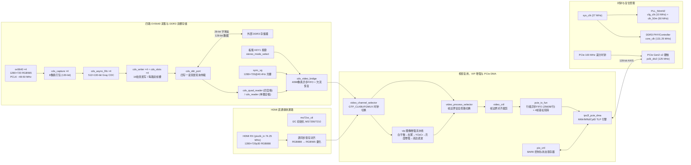

# 紫光同创 FPGA 端逻辑工程说明

本目录包含面向 **紫光同创 Logos-2 系列 FPGA (`PG2L50H-6IFBG484`)** 的 RTL 源码、IP 核配置、引脚与时序约束文件及仿真工程。FPGA 端作为多源视觉感知前端与高速传输枢纽，负责 **四路 OV5640 720p 并行采集、DDR3 多通道双帧槽缓冲、四宫格/单摄无撕裂读取、HDMI 720p30 接收、VIP 实时图像增强流水线、I2C 从机控制以及 PCIe Gen2 x2 行级 DMA 传输**。

## 顶层架构与数据通路 (`pcie_video.v`)



## 时钟域划分与跨时钟域（CDC）设计

系统内部包含多个独立异步时钟域，各模块边界均采用严格的跨时钟域同步设计：

| 时钟名称 | 频率 | 来源 | 驱动模块与 CDC 策略 |
| :--- | :--- | :--- | :--- |
| `sys_clk` | `27 MHz` | 板载晶振输入 | PLL 参考输入、DDR3 IP 参考时钟、`video_channel_selector` 按键消抖与状态控制 |
| `cfg_clk` | `10 MHz` | `PLL_50mHZ.clkout0` | 上电 1 ms 延迟复位生成（`rstn_out`）、MS7200/MS7210 HDMI 芯片 I2C 初始化状态机 |
| `clk_50m` | `50 MHz` | `PLL_50mHZ.clkout1` | 四路 OV5640 SCCB 配置、I2C 从机 (`0x66`)、`sync_vg` 1280×720 光栅发生器（`1650×750` 总周期，约 `40.40 Hz`）及摄像头输出像素域 |
| `cmos*_pclk` | `~48–50 MHz` | 4 路 OV5640 独立输入 | 各路 `cmos_capture_data` 在原生 PCLK 域拼接 16 位 RGB565 像素，凑齐 8 像素后写入 `cds_async_fifo`（Gray 码指针同步至 `core_clk`） |
| `core_clk` | `131.25 MHz` | DDR3 控制器输出 | `camera_ddr3_store` 核心时钟域，执行四路写突发与一路读突发的轮询仲裁，读出像素经 `cds_video_bridge` 内部 4096 像素异步 FIFO 跨越至 `clk_50m` |
| `pixclk_in` | `74.25 MHz` | MS7200 HDMI 接收器 | HDMI 1280×720p30 源同步像素时钟，输入信号先寄存一拍消除组合路径偏斜 |
| `mux_pclk` | `50 / 74.25 MHz` | `GTP_CLKBUFGMUX` | 经紫光同创专用时钟复用原语在下降沿无毛刺切换的统一后级视频时钟，驱动 `vip`、`video_process_selector`、`video_crtl` 及 `pcie_tx_fun` 写端口 |
| `pclk_div2` | `125 MHz` | PCIe 硬核输出 | PCIe Gen2 x2 用户数据面与 PIO 控制时钟域，通过 `pcie_tx_fun` 内部异步 FIFO 接收 `mux_pclk` 视频行数据 |

## 核心子系统详解

### 1. 四路摄像头采集与 DDR3 双帧槽存储 (`rtl/camera_ddr3_store/` & `rtl/video_control/`)

为避免四路异步摄像头同时写入与读取造成的画面撕裂或带宽冲突，`camera_ddr3_store` 构建了完整的四写一读帧缓存架构：

- **独立采集与 130-bit 异步 FIFO (`cds_capture.v` + `cds_async_fifo.v`)**：
  - 每路摄像头在各自 `cam_clk` 下将 8 个连续 16-bit RGB565 像素打包为 128-bit 数据，并附带帧首 `SOF` 与帧尾 `EOF` 标志位，组成 130-bit 条目写入深度为 512（容量 4096 像素 / 8 KiB）的异步 FIFO。
  - 若极端情况下发生 FIFO 满溢出，模块置位粘滞状态位 `capture_overflow[ch]` 并丢弃当前残帧剩余像素，绝不向 DDR3 发布半帧，待下一帧 `SOF` 自动恢复对齐。
- **DDR3 地址空间规划与双槽管理 (`cds_slots.v` + `cds_writer.v`)**：
  - DDR3 接口数据位宽 128-bit，地址位宽 28-bit（**以 16-bit 字为单位寻址**）。
  - 通道基地址：`Channel_Base = camera_id × 0x200000`；槽位偏移：`Slot_Offset = slot × 0x100000`（每路分配 Slot 0 与 Slot 1 两个独立帧槽，四路共占用 16 MiB）。
  - 单帧 `1280×720` 共 `921,600` 像素，每次写突发固定 16 拍（`AWLEN = 15`，传输 128 像素 = 2048 bits），每行 10 次突发，整帧精确完成 7200 次写突发且无协议错误后，才将该槽位标记为最新完成帧（`latest_valid`）并递增 32 位帧序号。
  - 当读端口正在锁定读取某槽位时，写端口自动向另一空闲槽位写入，实现无撕裂 Ping-Pong 切换。
- **四宫格下采样拼接与五档模式切换 (`cds_quad_reader.v` + `stereo_mode_select.v`)**：
  - 板载按键 `KEY1` 支持 20 ms 消抖，按 **`0: 四宫格 (Quad)` → `1: 相机1全幅` → `2: 相机2全幅` → `3: 相机3全幅` → `4: 相机4全幅` → `0: 四宫格`** 循环切换，模式变更严格在下一输出帧 `VS` 边界生效。
  - 四宫格模式下，`cds_quad_reader` 在帧起点同时锁存四路最新有效帧槽，按输出坐标 `(out_x, out_y)` 映射至对应象限（`Cam1` 左上、`Cam2` 右上、`Cam3` 左下、`Cam4` 右下），提取源帧偶行、偶列像素组成 `1280×720` 合成帧。
- **固定光栅桥接与欠流保护 (`cds_video_bridge.v`)**：
  - 将 `core_clk` 域可停顿的顺序读像素流通过 4096 像素异步 FIFO 转换为 `clk_50m` 域严格跟随 `sync_vg` 的 `1280×720` 光栅流。若某帧出现数据欠流或未就绪，当帧剩余像素安全填充黑电平并在后台排空至 `EOF`，确保下一帧像素绝对不会发生行列错位。

### 2. VIP 硬件图像增强流水线 (`rtl/video/vip/`)

当 ARM 端通过 I2C 将 `0x03[0]`（预处理总开关）置 1 时，`video_process_selector` 在下一个场同步（`vsync`）上升沿安全切换至 `vip` 处理通路。`vip.v` 内部先把 RGB565 高位复制扩展为 RGB888，随后依次流经以下硬件算子（最后再量化回 RGB565 送入 PCIe DMA）：

| 流水线阶段 | 模块名称 | 源文件 | 控制位 (`vip_crtl`) | 算法原理说明 |
| :--- | :--- | :--- | :--- | :--- |
| **Stage 1** | `image_awb` | `white_balance/white_be.v` | `vip_crtl[0]` (I2C `0x05`) | 基于灰度世界法统计整帧 R/G/B 均值，利用查找表与定点乘法动态计算三通道增益补偿 |
| **Stage 2** | `vip_dark_channel_top` | `dark_channel/*.v` | `vip_crtl[1]` (I2C `0x06`) | 计 RGB 三通道最小值图与 3×3/5×5 最小值滤波暗通道，估计全局大气光值与透射率图并恢复无雾辐射度 |
| **Stage 3** | `rgb2ycbcr` | `color_space/rgb2ycbcr.v` | 随 `vip_crtl[3]` 常开 | 定点流水线将 RGB888 转换至 YCbCr 色彩空间，分离亮度分量 `Y` 与色度分量 `Cb/Cr` |
| **Stage 4** | `light_enhance` | `light_enhance/*.v` | `vip_crtl[2]` (I2C `0x04`) | 统计亮度直方图分布，对 `Y` 分量执行自适应低照度增强与对比度拉伸 |
| **Stage 5** | `vip_bilateral_filter` | `bilateral_filter/*.v` | 随 `vip_crtl[3]` 常开 | 利用行移位 RAM 构建局部邻域窗口，对 `Y` 分量执行空域+值域双边保边去噪滤波 |
| **Stage 6** | `ycbcr2rgb` | `color_space/ycbcr2rgb.v` | 随 `vip_crtl[3]` 常开 | 将增强与滤波后的 `YCbCr` 还原为 24-bit `RGB888` 并截取高 `5/6/5` 位输出 `RGB565` |

> **工程说明**：顶层 `pcie_video.v` 中原车牌定位与画框模块（`vdp` / `vdp_box_draw`）已注释移除，I2C 寄存器 `0x04`（对应 `rk_box_draw_ctrl[0]`）在当前 RTL 中实际连接至 `vip_crtl[2]`，即控制 **`light_enhance`（自适应亮度增强）** 子模块。

### 3. PCIe Gen2 x2 行级 DMA 引擎 (`rtl/pcie/`)

- **帧边界对齐 (`video_crtl.v`)**：仅在收到 `pio_crtl` 的启动标志 `start_flag = 1` 且检测到完整新帧 `vsync` 后才放行有效像素 `de`，防止采集启动瞬间传输残缺首帧。
- **跨时钟域组包与四槽轮转 (`pcie_tx_fun.v`)**：
  - 每个帧边界同步复位内部 `video_clk -> pcie_clk` 异步 FIFO（位宽转换 `16-bit -> 128-bit`）。
  - 每写入一行（`1280 像素 = 2560 Bytes`）向 `pclk_div2` 域发起一次行级 DMA 请求（`video_dma_len = 640 DW`），避免在片上消耗整帧 BRAM。
  - 累加满 720 次行 DMA 完成信号（`dma_tx_done`）后，置位帧完成脉冲 `o_dma_wr_done`，并将帧槽索引 `o_dma_wr_index` 在 `0 → 1 → 2 → 3 → 0` 之间循环递增，切换至对应的 64 位主机物理基地址（`dma_base_addr` ~ `dma_base_addr4`）。

## 目录结构

```text
FPGA/prj/
├── pcie_video.pds                # PDS 工程主文件 (器件 PG2L50H-6IFBG484)
├── pcie_video.fdc                # 顶层引脚分配与时钟约束
├── constraints/                  # 摄像头与 HDMI 独立测试约束备份
├── generate_bitstream/           # 编译生成的位流文件 (.sbit)
├── ipcore/                       # 紫光同创 IP 核目录 (PLL_50mHZ, ddr3, pcie_test 等)
├── sim/                          # VIP 图像算法仿真脚本与测试图像
└── rtl/
    ├── pcie_video.v              # FPGA 顶层模块
    ├── camera_ddr3_store/        # 四路摄像头 DDR3 双槽存储子系统
    │   ├── camera_ddr3_store.v   # 存储子系统顶层
    │   ├── cds_capture.v         # 8 像素打包与 SOF/EOF 标记生成
    │   ├── cds_async_fifo.v      # 512×130-bit Gray 码异步 FIFO
    │   ├── cds_slots.v           # 双帧槽状态机与读锁定保护
    │   ├── cds_writer.v          # 16 拍突发写控制器
    │   ├── cds_reader.v          # 单路全幅顺序读与随机坐标读控制器
    │   ├── cds_ddr_port.v        # 四写一读突发轮询仲裁器
    │   ├── cds_camera_select.v   # 按键消抖与通道选择辅助模块
    │   └── cds_video_bridge.v    # 顺序读流转固定 50MHz 光栅异步桥
    ├── video_control/
    │   ├── cds_quad_reader.v     # 四路帧槽偶行偶列下采样四宫格拼接读取器
    │   ├── video_channel_selector.v # 摄像头/HDMI 视频源与时钟复用器
    │   └── video_process_selector.v # 原始流与 VIP 增强流帧边界切换器
    ├── stereo_stitch/            # KEY1 五档模式选择与双摄拼接扩展模块
    ├── ov5640/                   # OV5640 SCCB 寄存器配置表 (1280×720 RGB565) 与 DVP 采集
    ├── hdmi/                     # MS7200 (RX) / MS7210 (TX) I2C 配置状态机
    ├── video/vip/                # VIP 图像增强流水线 (白平衡/去雾/亮度增强/双边滤波)
    ├── iic_slave/                # I2C 从机接口 (0x66, 寄存器 0x00~0x06)
    ├── pcie/                     # PCIe DMA 控制器 (ips2l_pcie_dma)、TX 组包与 PIO 模块
    └── debug/uart/               # 串口字节与数据包发送模块 (115200 8N1)
```

## PDS 工程构建与上板说明

1. **工具版本**：推荐使用 **Pango Design Suite (PDS) 2022.2-SP6.4**。
2. **器件型号**：`PG2L50H-6IFBG484`（Logos-2 系列，封装 FBG484，速度等级 `-6`）。
3. **检查源文件引用**：打开 `FPGA/prj/pcie_video.pds` 后，确认 `rtl/camera_ddr3_store/` 下的 9 个模块及 `rtl/video_control/cds_quad_reader.v`、`rtl/stereo_stitch/stereo_mode_select.v`、`rtl/stereo_stitch/stereo_read_mux.v` 已包含在工程源文件列表中；若工程树中存在已废弃的旧文件引用（如已注释的 `vdp` 相关文件），在 PDS File List 中将其移除后再执行 **Compile → Synthesize → Device Map → Place & Route → Generate Bitstream**。
4. **板载按键与指示灯定义**：
   - `button_rst_n`：全局异步复位（低有效）。
   - `key1`：本地显示模式循环切换（低有效，20 ms 消抖：四宫格 → 单摄 1 → 单摄 2 → 单摄 3 → 单摄 4 → 四宫格）。
   - `heart_beat_led`：DDR3 初始化完成且 `core_clk`（131.25 MHz）正常运行时以 `1 Hz` 闪烁。
   - `ref_led`：PCIe 100 MHz 参考时钟正常时闪烁。
   - `smlh_link_up`：PCIe 物理层链路训练成功指示。
