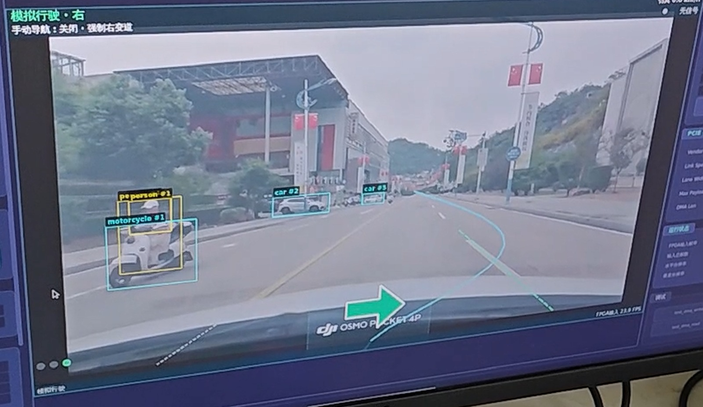
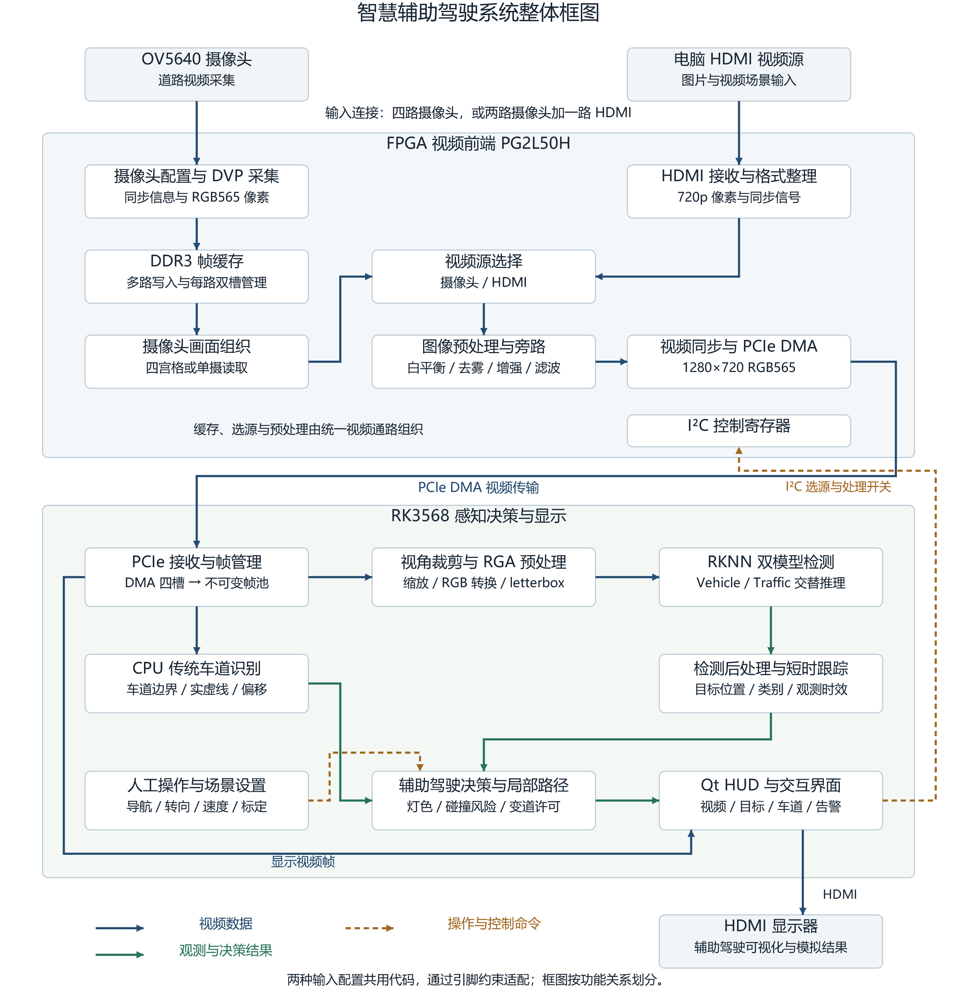
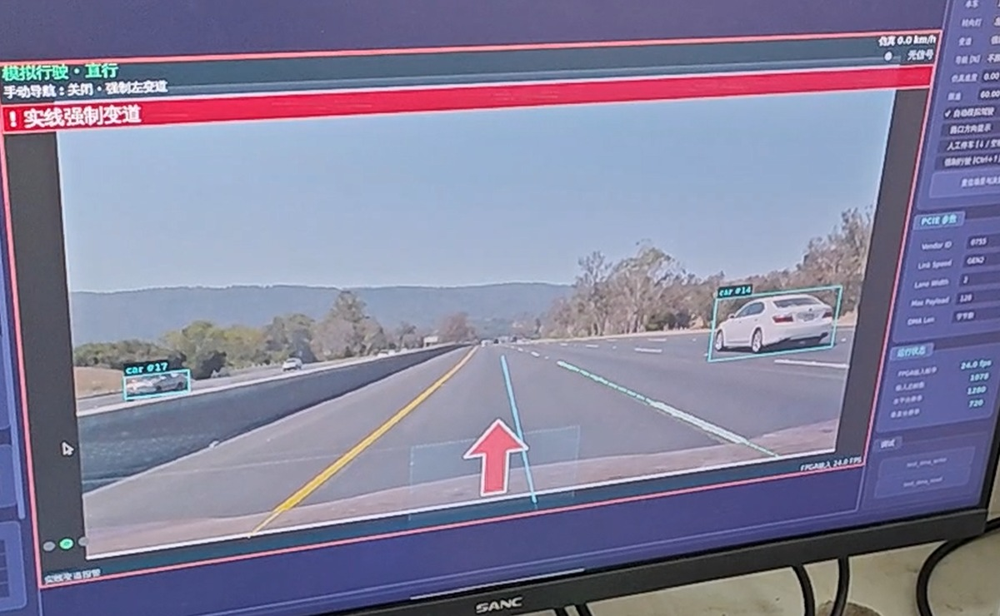
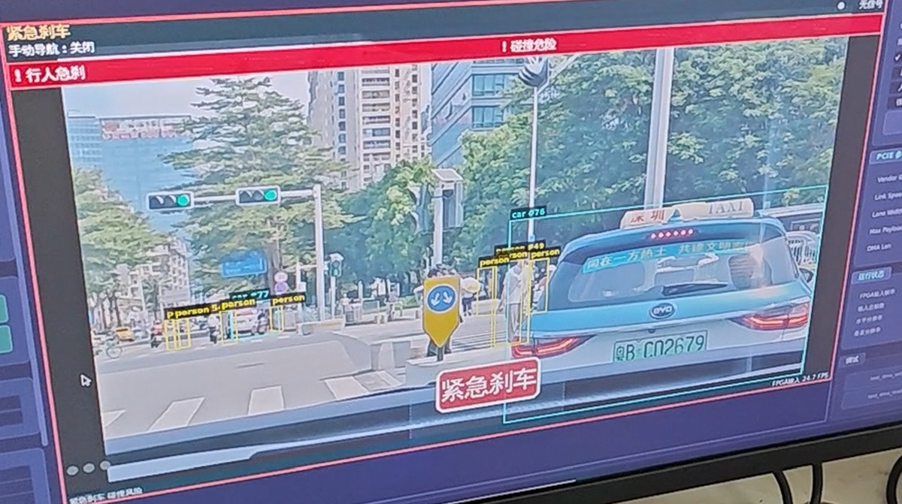
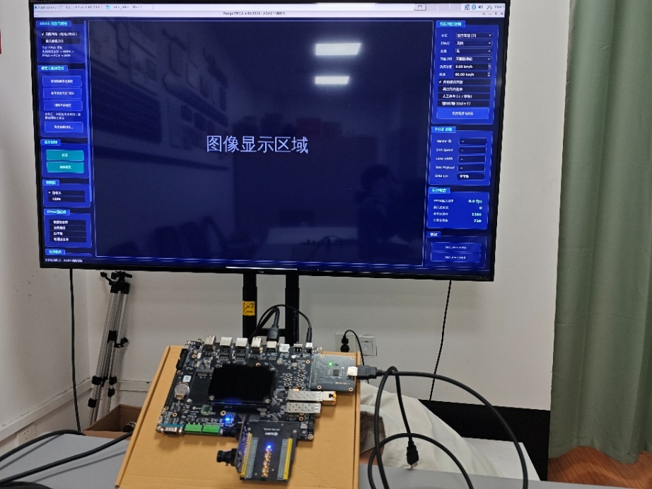

# FPGARACE 2026 · FPGA 高级辅助驾驶演示系统

本项目是 **2026 年全国大学生嵌入式芯片与系统设计竞赛 FPGA 创新设计赛道（紫光同创杯）选题三**的参赛工程。系统基于紫光同创 **PG2L50H FPGA** 与瑞芯微 **RK3568J**，完成多路视频采集、图像增强、道路感知与辅助驾驶决策，并在 Qt 界面中叠加显示检测框、车道边界、局部路径和风险提示。车速、导航和驾驶动作由界面模拟。

[技术报告（PDF）](doc/技术文档.pdf) · [ARM 开发指南](arm/README.md) · [FPGA 工程指南](FPGA/README.md)



*板端演示中的右侧虚线变道与局部路径提示。*

## 系统架构

FPGA 接收四路 OV5640 摄像头或 HDMI 道路素材，将选中的视频源统一为 **1280×720 RGB565**。摄像头模式下，DDR3 为每路保存两个全分辨率帧槽，读出时可组织成四个 640×360 视区或输出单摄全幅。四宫格从左上到右下依次对应前、右、后、左视角。

| 子系统 | 职责 |
| --- | --- |
| FPGA | 并行视频采集、DDR3 帧缓存、四宫格组织，以及白平衡、暗通道去雾、亮度增强和双边滤波 |
| FPGA ↔ ARM | PCIe Gen2 x2 以行级 DMA 传输视频，每行 2560 字节，主机侧使用四帧环形缓冲。BAR0 控制采集启停，I2C（`/dev/i2c-0`，地址 `0x66`）控制输入源与增强选项 |
| RK3568J · RGA / NPU | RGA 硬件裁剪、缩放与色彩转换。NPU 交替运行两个 INT8 模型，识别行人、车辆、信号灯和斑马线 |
| RK3568J · CPU / Qt | OpenCV 提取前视车道边界并判别虚实线，结合目标跟踪和输入时效生成决策，再由 Qt 显示路径与报警 |

<p align="center">
  
</p>

<details>
<summary>PCIe BAR0 与 I2C 寄存器速查</summary>

单帧固定为 1,843,200 字节，FPGA 每帧发出 720 次行级 DMA 请求。BAR0 偏移与状态位见 [PIO 实现](FPGA/prj/rtl/pcie/pio_crtl.v)。

| BAR0 字节偏移 | 用途 |
| --- | --- |
| `0x000` | 写 `0xFFFFFFE5` 启动发送，写 `0xFFFFFF00` 停止 |
| `0x050/0x054`、`0x020/0x024`、`0x040/0x044`、`0x030/0x034` | 依次为槽位 0–3 的 64 位 DMA 基地址，每对分别写入低、高 32 位 |
| `0x060` | 写 1 锁存 DMA 配置 |
| `0x140` | bit 0 为帧完成标志，读后清除。bits 2:1 为帧槽编号 |

I2C `0x00` 用于回环测试，`0x01` 选择视频源（0 为摄像头、1 为 HDMI），`0x02` 读回实际源。`0x03` 为 VIP 总开关，`0x04`、`0x05`、`0x06` 分别控制亮度增强、白平衡和去雾。各开关使用 bit 0，独立算子在总开关开启时生效。[I2C 寄存器实现](FPGA/prj/rtl/iic_slave/registerInterface.v)

</details>

## 演示与实测

可使用 HDMI 回放路口和道路素材，观察分车道灯控、红灯强行驶报警、虚实线变道判定、斑马线行人急刹和碰撞风险提示。界面提供仿真车速与限速输入，也可设置各车道信号灯 ROI，使用实测地面矩形做四点标定。

| 实线强制变道报警 | 斑马线行人急刹提示 |
| :---: | :---: |
|  |  |

| 测量项 | 报告记录 |
| --- | ---: |
| 四路摄像头模式 YOLO 推理合计 | 约 10 FPS |
| HDMI 单前视模式 YOLO 推理 | 约 20 FPS |
| 系统延时 | 约 80 ms |

四路模式按视区调度检测任务，表中的 10 FPS 为合计值。Qt 导出的诊断 JSON 另行记录从 ARM 接收回调到 HUD 更新的延迟。板端数据见[技术报告 §3.3.4](doc/技术文档.pdf#page=21)。

## 快速开始

<p align="center">
  
</p>

1. **准备 FPGA。** 用 PDS 2022.2-SP6.4 打开工程，按板卡与输入配置核对约束，通过 JTAG 下载相应位流。摄像头四路演示时，将 `KEY1` 模式设为四宫格。HDMI 回放时，将电脑接到 HDMI IN 并设置为 1280×720、30 Hz。[FPGA 构建与上板说明](FPGA/README.md#pds-工程构建与上板说明)
2. **准备 RK3568J。** 使用 64 位 Linux 图形会话，准备 Qt 5、OpenCV 4 和兼容的 RGA、NPU 环境。先检查内核是否与附带 PCIe 模块兼容，并确保运行账号可以访问 `/dev/pango_pci_driver`、`/dev/i2c-0` 和 `/dev/mem`。[ARM 环境与构建说明](arm/README.md#环境要求与构建说明)
3. **启动并采集。** 在 RK3568J 的仓库根目录执行以下命令。PCIe 模块已加载时，跳过 `insmod`。

```bash
cd arm
uname -r
modinfo drivers/pango_pci_driver_mul.ko
sudo insmod drivers/pango_pci_driver_mul.ko
bash build.sh --check
bash build.sh
sh ./run_adas.sh --mode raw
```

在窗口中依次点击 **打开**、选择 **摄像头** 或 **HDMI**、点击 **采集视频**。确认画面后，切换到 **ADAS 辅助驾驶**，设置当前车道和演示参数。[ARM 运行与交互说明](arm/README.md#运行参数与交互指南)

## 仓库内容

| 路径 | 内容 |
| --- | --- |
| [arm/](arm/) | Qt/C++ 应用、PCIe 驱动、RKNN 模型与构建脚本 |
| [FPGA/](FPGA/) | PDS 工程、Verilog RTL、IP、引脚约束、位流与仿真素材 |
| [doc/](doc/) | 技术报告（[PDF](doc/技术文档.pdf)、[Word](doc/技术文档.docx)）及 README 配图 |

## 第三方组件

模型来源与许可见 [RKNN 模型记录](arm/models/adas/provenance.json)和[随附许可](arm/models/adas/licenses/)。Pango IP、I2C 从机与图像处理模块保留各自的版权及许可声明。
