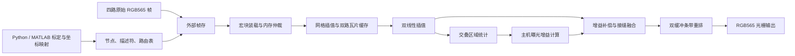
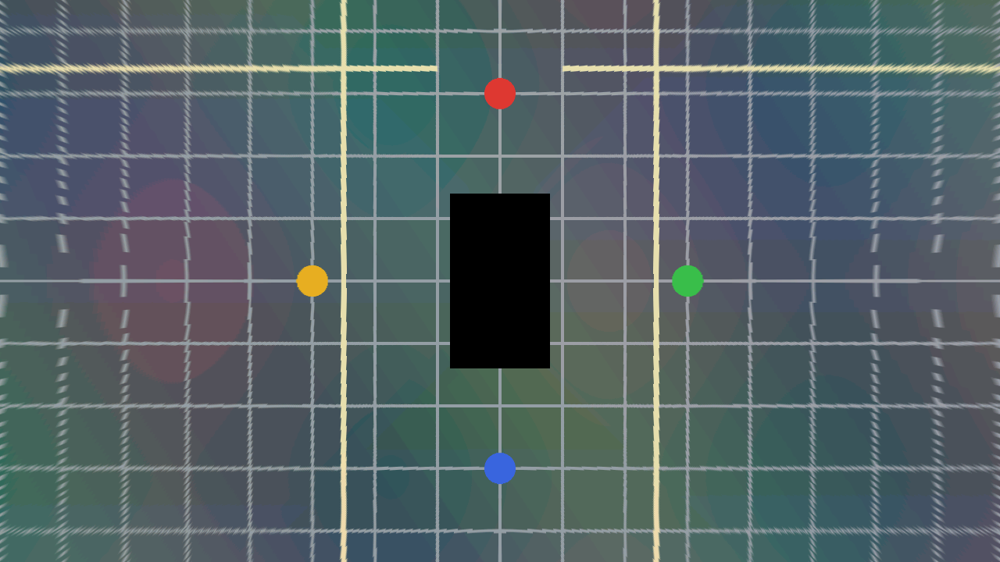

# 四路环视 FPGA 核心 · RK3568_50H / Pango PG2L50H

面向紫光同创 RK3568_50H 板卡的四路摄像头地面鸟瞰（AVM / BEV）拼接工程。当前实现覆盖 **离线标定与查找表生成 → 外部帧存读取 → FPGA 插值、融合和重排 → RGB565 光栅输出**，并提供 Python、MATLAB、ModelSim 与 PDS 的验证流程。

> **当前状态：算法参考、RTL 仿真、PDS ADS 综合和完整 720p 综合网表功能仿真已完成；尚未上板。**
> 尚未完成板级摄像头采集、物理 DDR/PCIe 适配、RK3568 显示、管脚约束和布局布线；本仓库没有可直接烧录运行的完整系统 bitstream。

本 README 对应 2026-10-03 的设计与验证状态。公开仓库保存可复现源码和经过隐私审查的验证摘要；本地原始日志、完整测试数据与备份不随 Git 提交。

## 1. 已完成与待完成

| 项目 | 状态与证据范围 |
|---|---|
| FPGA 算法核心 | 8 个可综合 Verilog 模块，顶层 `avm_core` |
| 定点算法参考 | Python 位精确模型、独立标量与几何验证；13 项测试通过 |
| MATLAB 参考 | 四组样例已执行独立双精度全帧参考验证；目录整理回归复用这些参考，没有重新调用 MATLAB |
| RTL 单元仿真 | ModelSim 9 次单元运行通过，覆盖算术、缓存、重排、配置、DDR 事务等 |
| RTL 整帧回归 | 8 组运行、10 帧、5,541,888 个像素逐一一致，含压力与跨帧增益更新 |
| PDS ADS 综合 | `PG2L50H-6IFBG484`，1280×720，100MHz 目标，资源容量满足 |
| 综合网表功能仿真 | 使用本机 Pango 官方原语模型，完整 921,600 像素通过；无 SDF |
| 管脚、CDC、物理 DDR/PCIe、布局布线 | **待实现或验证** |
| 四路真实相机 + RK3568 显示联调 | **未上板，未验证** |

上述结果绑定已验证的源文件 SHA256，见 [公开验证摘要](doc/validation/README.md) 和 [机器可读结果](doc/validation/results.json)。公开摘要提取自真实工具输出，不冒充未经修改的原始日志。

## 2. 数据通路与实现边界



这里的四路输入是已写入外部帧存的四路图像。仿真通过 DDR 事务模型提供这些数据；工程尚未提供真实摄像头接收器或物理 DDR 控制器。主机曝光反馈由 Python 静态帧回放验证，尚无实时 RK3568 驱动。

- 去畸变、地面投影、旋转和画布缩放合成为 BEV→原图坐标，每路原图只进行一次图像重采样。
- 16×16 宏块使用 16/8/4/2/1 自适应网格步长，按量化后误差选取；目标为有效像素源坐标误差不超过 0.25 像素。
- 双路瓦片缓存提取双线性插值所需四邻域，支持邻接瓦片预取、4KiB 边界拆分与背压。
- Q4.12 曝光增益、Alpha 查表与融合后输出 RGB565。配置先写入影子寄存器，再在下一帧开始时原子切换。
- 双 16 行缓存将宏块计算顺序恢复为光栅顺序，输出包含 `valid/ready`、SOF、EOL。
- 地面平面模型会造成高物体拉伸；不同步输入和运动物体可能重影，当前结果不代表真实道路场景已实现无缝融合。

### RTL 模块

| 模块 | 职责 |
|---|---|
| `avm_core.v` | 宏块调度、配置管理、统计、数据通路集成 |
| `avm_patch_store.v` | 节点与宏块数据装载、双缓冲查询 |
| `avm_grid_interp.v` | Q8 坐标网格插值，四级弹性流水线 |
| `avm_tile_cache.v` | 双线性四邻域缓存、DDR 突发与预取 |
| `avm_bilinear.v` | RGB565 四邻域插值，三级流水线 |
| `avm_gain_blend.v` | 增益、饱和与接缝融合，两级流水线 |
| `avm_mem_arbiter.v` | LUT / 两路缓存请求仲裁 |
| `avm_stripe_reorder.v` | 宏块到光栅重排及输出背压处理 |

详细位宽、舍入、配置与 DDR 文件布局见 [接口契约](doc/avm/implementation-contract.md)。RTL 未使用 Xilinx DSP48 或 HLS IP，由 PDS 推断 Pango APM/DRM。

## 3. 目录结构

```text
.
├── README.md
├── src/
│   ├── rtl/                  # 唯一维护的生产 RTL
│   └── files.f               # 相对仓库根目录的 RTL 清单
├── sim/
│   ├── run.py                # 可从任意当前目录调用的 ModelSim 入口
│   ├── tb/                   # 9 个 SystemVerilog 测试文件
│   ├── models/               # DDR 事务行为模型
│   ├── data/README.md        # 数据生成说明，完整样例不入 Git
│   └── wave.do
├── constraints/avm_core.fdc # 100MHz 核心时钟约束
├── project/pds/build.tcl     # 隔离 PDS 工程模板
├── tools/
│   ├── avm/                  # 算法、生成、运行、报告、打包
│   └── release/              # 发布前敏感信息与暂存内容检查
└── doc/
    ├── avm/                  # 接口、算法说明
    ├── validation/           # 公开验证摘要与源文件哈希
    ├── figures/              # 实际 RTL 合成场景输出
    └── plans/                # 本次发布计划
```

运行后生成 `sim/data/<case>/`、`build/avm/` 和 `doc/avm/` 下的本地报告；交付 ZIP 写入 `archive/releases/`。这些大体积或带机器路径的生成文件由 `.gitignore` 排除。完整本机备份、旧规划、厂商原语文件和工具许可证不属于提交内容。

## 4. 环境准备

已验证环境为 Windows、Python 3.13、ModelSim 10.7、MATLAB R2024b、PDS 2022.2-SP6.4。Python 源码要求 3.10+；其他工具版本未完整验证。PDS 运行器使用 Windows API 与临时 SUBST，当前主要支持 Windows。

```powershell
git clone https://github.com/StellatoL/FPGARACE_2026_Pango_3.git
cd FPGARACE_2026_Pango_3
python -m venv .venv
.\.venv\Scripts\Activate.ps1
python -m pip install -r tools/avm/requirements.txt
```

若 PowerShell 不允许激活，可直接使用 `.\.venv\Scripts\python.exe` 替代下文的 `python`。

| 工具 | 要求 |
|---|---|
| Python | NumPy、SciPy、OpenCV、Matplotlib，版本范围见 requirements.txt |
| ModelSim | `vlib`、`vmap`、`vlog`、`vsim` 在 PATH；覆盖率需要 `vcover`，波形转换需要 `vcd2wlf` |
| PDS | 默认 `C:/pango/PDS_2022.2-SP6.4`，可用 `--pds-home` 覆盖 |
| MATLAB | 生成器默认 `C:/Program Files/MATLAB/R2024b/bin/matlab.exe`；其他位置可直接从 MATLAB 调用参考函数 |

本机 ModelSim 的路径示例：

```powershell
$env:PATH = "C:\modeltech64_10.7\win64;" + $env:PATH
vlog -version
vsim -version
```

PDS、ModelSim 和 MATLAB 需自行安装并正常取得许可证；仓库不提供授权文件或安装包。

## 5. 从全新克隆开始仿真

### 5.1 先生成小尺寸样例并做快速检查

全新克隆没有完整 fixture；必须先生成输入。下面的 small 样例不需要网络或 MATLAB：

```powershell
python -X utf8 tools/avm/generate.py --case small
python -X utf8 sim/run.py --case small --profile stress --wave
python -X utf8 tools/avm/run_units.py
```

帧测试成功时输出 `pass_bit_exact: true`，原始 ModelSim 日志包含 `PASS: tb_avm_frame`。失败、缺少 PASS、像素不一致或 ModelSim Error/Fatal 会返回非零退出码。

输出位于 `build/avm/simulation/<case-profile-time>/`，包括编译/仿真日志、输入 SHA256、实际 `rtl_output.hex`、输出 PNG 与统计。单元输出位于 `build/avm/units/<time>/`。

### 5.2 完整回归与 MATLAB 参考

```powershell
python -u -X utf8 tools/avm/run_all.py --regenerate --matlab --full-stress
python -X utf8 tools/avm/render_report.py
python -X utf8 tools/avm/collect_report.py
```

第一条命令生成四组样例、调用 MATLAB、运行 13 项 Python 测试和 9 次 RTL 单元运行，再完成整帧、压力、曝光反馈与跨帧配置测试。`--full-stress` 增加完整 720p 随机压力运行。最终回归记录位于 `build/avm/latest-regression.json`。

公开实拍样例首次生成需要访问固定版本的上游 GitHub 文件；已校验缓存位于 `sim/data/public_source/`，后续可离线使用。图像和系数都必须通过 SHA256 核对。

若仅需 Python/RTL，可以省略 `--matlab`；但 `collect_report.py` 要求四组 `matlab_verification.json`，缺少 MATLAB 参考时不能宣称完成算法报告验收。`--matlab` 只在生成阶段生效：已有样例要重算 MATLAB 必须同时使用 `--regenerate`。

MATLAB 路径不同时，在 MATLAB 中运行（先按上文生成四组输入）：

```matlab
addpath('tools/avm');
verify_mapping('sim/data/small');
verify_mapping('sim/data/synthetic720');
verify_mapping('sim/data/synthetic720-wide');
verify_mapping('sim/data/public');
```

已有完整样例只重跑回归：

```powershell
python -u -X utf8 tools/avm/run_all.py --full-stress
```

Python fixture 测试在输入缺失时可能跳过；验收时应确认 **13 项通过且 0 跳过**。

### 5.3 四组输入

| case | 原图 → 输出 | 用途 |
|---|---|---|
| `small` | 四路 128×96 → 64×48 | 快速功能、波形、配置切换 |
| `synthetic720` | 四路 1280×720 → 1280×720 | 独立射线生成原图，物理标定，64px 有限接缝 |
| `synthetic720-wide` | 同上 | 保持原图和几何映射，全交叠压力配置 |
| `public` | 四路 960×640 → 1280×720 | 公开实拍样例；有效鸟瞰 540×720 居中补边 |

生成目录保留 `memory.hex/bin`、`expected.hex/bin`、`frame.json`、标定、参考图和 NPZ/MAT。`frame_feedback.json` 与 `expected_feedback.hex` 用于第二帧增益更新。公开样例的输出补边不能当作四路 720p 实拍吞吐证据。

### 5.4 定向测试、覆盖率和波形

```powershell
python -X utf8 sim/run.py --case synthetic720
python -X utf8 sim/run.py --case synthetic720-wide
python -X utf8 sim/run.py --case small --profile stress --seed 0xdeadbeef --no-latest
python -X utf8 sim/run.py --case small --profile stress --coverage --no-latest
python -X utf8 tools/avm/run_units.py --coverage
```

`--seed` 为非零 32 位整数；`--prefetch` 支持 1/2/4。`--feedback` 要求先准备第二帧配置，完整回归会自动生成。`--no-latest` 保留标准回归指针；不要同时启动同一 case/profile，以免秒级输出目录重名。

该 ModelSim 安装对原模块名的覆盖率采集存在限制，工具在可逆重命名副本上统计，保存 `coverage-source-map.json`；生产 RTL 不改写。small 覆盖率用于检查入口，不能等同于完整测试集覆盖率。

`--wave` 生成 `core.vcd`。在对应运行目录执行 `vcd2wlf core.vcd core.wlf`，打开 WLF 后加载 `sim/wave.do`。720p 默认不记录全波形，以控制存储量。

## 6. PDS 综合与综合网表验证

```powershell
python -u -X utf8 tools/avm/run_pds.py --label verified
```

运行器在 `build/avm/pds/<label-time>/` 冻结 RTL、FDC、Tcl 与输入哈希，调用原生 ADS 综合。`project/pds/build.tcl` 的 `../rtl` 相对生成目录解析，请通过运行器创建工程。生成的 `prj/avm_core.pds` 可在 PDS 中打开。

默认目标为 Logos2、`PG2L50H-6IFBG484`、1280×720、核心 100MHz，关闭 I/O 插入。运行器会临时映射当前工作区驱动器别名以适配该 PDS 版本，结束后解除映射。

将下面尖括号占位符替换为工具打印的实际目录：

```powershell
python -u -X utf8 tools/avm/run_gate_sim.py --build build/avm/pds/<verified-time> --case synthetic720 --timeout 3600
python -X utf8 tools/avm/collect_pds_report.py --selected build/avm/pds/<verified-time> --gate build/avm/gate-simulation/<gate-time>
python -X utf8 tools/avm/collect_report.py
```

综合网表尺寸在编译时固定，必须与样例相同。快速网表调试可综合 `--width 64 --height 48` 并用 `--case small`；当前 PDS 报告收集器要求完整 720p 构建及对应网表运行。

网表仿真从本机 PDS 安装目录加载官方原语，采用 `+delay_mode_zero` 与 `+notimingchecks`，**没有 SDF，也没有布局布线时序签核**。`--compile-only` 只检查编译，不能作为功能通过。

## 7. 已测结果与性能条件

| 1280×720 场景 | 最后一帧处理耗时 | 33.33ms 目标 |
|---|---:|---|
| 合成图，64px 有限接缝，标称 DDR | 28.31660ms | 达到 |
| 公开实拍样例，标称 DDR | 26.69724ms | 达到；输入为四路 960×640 |
| 合成图，全交叠，标称 DDR | 36.34548ms | **未达到** |
| 合成图，有限接缝，随机压力 | 54.58745ms | **未达到** |
| 合成图，第二帧应用曝光增益 | 28.31711ms | 达到 |

条件：核心 100MHz，DDR 等效 131.25MHz / 128bit，首拍等待 8 个 DDR 周期加 2 个核心周期，核心域最多一拍/周期；四路 RGB565 720p30 采集以 221.184MB/s 的虚拟写任务占用服务时间。随机压力增加首拍等待、请求/响应气泡和输出背压。该事务模型未模拟物理 CDC、DRAM 刷新、行命中或真实控制器调度。

耗时从输入帧已就绪后的 `start` 到最后像素完成，不是摄像头到显示器的端到端延迟，也不是 FPGA 实测帧率。

| PDS ADS 资源 | 使用 / 容量 | 占用 |
|---|---:|---:|
| LUT | 9,732 / 35,800 | 27.184% |
| 寄存器 | 8,871 / 71,600 | 12.390% |
| DRM36K | 52 / 85 | 61.176% |
| APM | 66 / 120 | 55.000% |

综合估计 Fmax **103.8529MHz**，100MHz 目标下 setup slack **+0.371ns**，无锁存器。这是 ADS 估计，不能推断完成布局布线后仍满足时序。

下面是从 **真实 ModelSim RGB565 输出**解码得到的合成场景鸟瞰；没有用算法参考图替代 RTL 输出，也不是上板照片：



## 8. 主要接口

| 接口 | 约定 |
|---|---|
| 时钟/复位 | `clk`；低有效同步复位 `rst_n` |
| 启动 | `start && !busy` 锁存源图尺寸、步长及四路基址；直到 done 保持输入帧和 LUT 有效 |
| 内存请求 | 字节地址 `req_addr[31:0]`，16 字节对齐，`req_len[4:0]` 表示 1～16 个 128bit 拍 |
| 内存响应 | `rsp_valid/rsp_ready/rsp_data[127:0]/rsp_last`；单个在途读，突发不跨 4KiB |
| 图像输出 | `m_valid/m_ready/m_pixel[15:0]/m_sof/m_eol`；背压时像素及标记保持 |
| 配置 | `cfg_kind=0` 写增益，`1` 写 Alpha，`2` 提交版本；下一帧原子生效 |
| 统计 | 前左、前右、后左、后右四组增益前 RGB 和/样本数；排除暗区与饱和区 |

当前接口均属于核心时钟域，接入异步外设时必须自行实现 CDC、事务冲刷和复位联动。完整寄存器、位宽和数值规则以 [接口契约](doc/avm/implementation-contract.md) 为准。

## 9. 上板前剩余工作

1. 核对实际板卡原理图、摄像头接口、时钟和 DDR 器件，建立板级顶层及真实管脚约束。
2. 接入四路采集和物理 DDR，适配地址、突发、帧同步、缓存一致性和复位流程。
3. 按实际链路实现 FPGA↔RK3568 数据通道、主机驱动及显示输出；当前 PCIe 尚无实现验证。
4. 完成 CDC 检查、时钟与 I/O 时序预算、Device Map、布局布线和 setup/hold 签核。
5. 采集真实标定与同步图像，验证曝光反馈、接缝、高物体、运动物体及真实内存压力。
6. 上板测量输出正确性、持续帧率、端到端延迟和稳定性，再更新状态与提交说明。

## 10. 公开内容、敏感信息与许可

提交仅包含明确列出的源码、工具、说明和验证摘要。原始日志中的个人目录、机器标识、许可证信息、完整工程备份、测试数据大文件以及 Pango 安装目录内容不进入 Git。源文件保留原始换行，Git blob SHA256 与验证基线一致；新增文档使用 LF。

发布前运行 `python tools/release/check_publication.py`，扫描 **Git 暂存 blob** 并检查文档链接、源码哈希与文件范围。扫描器不回显疑似秘密值。自动扫描不能证明不存在所有未知敏感信息，因此提交文件列表和输出图也经过人工式逐项审查。

公开实拍输入来源于 [surround-view-system-introduction](https://github.com/neozhaoliang/surround-view-system-introduction)，固定提交 `0c40d7e12443a7f16b2adae6f79fae2f6d6ee071`，生成器按文件校验 SHA256。上游 MIT 声明见 [THIRD_PARTY_LICENSE.txt](tools/avm/THIRD_PARTY_LICENSE.txt)；本仓库沿用远端已有的 [Apache-2.0 许可证](LICENSE)，本次提交保持 LICENSE 原文不变；上游样例的 MIT 声明单独保留。工具和厂商模型遵守各自许可。

[算法工具说明](tools/avm/README.md) · [仿真说明](sim/README.md) · [PDS 说明](project/README.md) · [验证摘要](doc/validation/README.md) · [发布计划](doc/plans/2026-10-03-github-publication.md)
