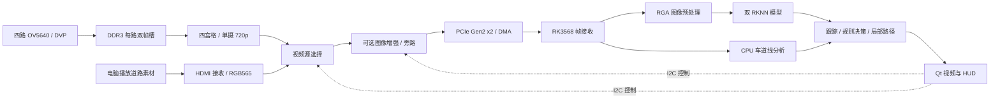

# FPGARACE 2026 · 紫光同创 FPGA + RK3568 辅助驾驶系统

本项目面向全国大学生嵌入式芯片与系统设计竞赛 2026 FPGA 赛道选题三：**以紫光同创 FPGA 为核心的高级辅助驾驶系统**。系统使用 FPGA 完成视频采集、帧缓存、四路画布组织、图像增强与 PCIe 传输，在 RK3568 上完成目标识别、车道线分析、模拟驾驶决策和 Qt 界面显示。

本仓库包含 ARM 应用、FPGA RTL/IP、驱动二进制、RKNN 模型和部分仿真素材。以下说明依据当前目录中的源码与配置整理；功能描述表示已有实现入口，实际帧率、识别精度、时序和整机效果需要在目标板上验证。

## 阅读入口

| 文档 | 内容 |
| --- | --- |
| [ARM 使用与开发说明](arm/README.md) | RK3568 环境、构建与运行、模型、快捷键、标定、诊断报告 |
| [FPGA 工程说明](FPGA/README.md) | PDS 工程、摄像头与 HDMI 通路、DDR3、PCIe/DMA、I2C、约束与仿真 |

## 系统架构



### 软硬件分工

| 部分 | 当前源码职责 |
| --- | --- |
| FPGA | 四路 OV5640 RGB565 采集；每路完整 1280×720 帧的 DDR3 双槽存储；四宫格或单摄输出；HDMI 输入；可选白平衡、暗通道去雾、亮度增强与双边滤波；PCIe 视频 DMA |
| RK3568 RGA | 将 RGB565 视区裁剪、缩放并转换为模型需要的 RGB 输入；神经网络图像预处理没有 CPU 降级路径 |
| RK3568 NPU | `vehicle.rknn` 提供行人和车辆感知；`traffic.rknn` 提供斑马线、信号灯及斑马线行人关系 |
| ARM CPU / OpenCV | 前视车道线拟合、虚实线判断、目标跟踪、标定换算、碰撞风险与变道规则、局部模拟路径 |
| Qt | 视频显示、检测框、车道与路径叠加、驾驶状态/报警、手动模拟、标定和性能诊断 |

### 视频与通信约定

- FPGA → ARM 固定传输一张 **1280×720、RGB565、每像素 2 字节**的图像，单帧 **1,843,200 字节**。
- 摄像头四宫格由四路完整帧分别隔行、隔列取样为 640×360 后组成。它是四个视角的画布，未实现环视几何融合或无缝鸟瞰。
- 摄像头 1/2/3/4 分别位于左上/右上/左下/右下；ARM 将其解释为前/右/后/左，接线时应按这个顺序安排视角。
- FPGA 本地 `KEY1` 可在四宫格和四个全幅单摄之间循环；ARM 目前只按 I2C 源状态区分“摄像头四宫格”和“HDMI 单前视”。运行四路 ADAS 时应保持 FPGA 为四宫格。
- HDMI 路径以 1280×720 逐行 30 Hz 输入为使用目标；道路素材在电脑端播放，经 HDMI 进入 FPGA，再经 PCIe 到 ARM。ARM 应用没有本地视频文件/USB 摄像头输入选项。
- PCIe 配置为 Gen2 x2，DMA 以每行 2560 字节组织，主机使用四帧环形缓冲。I2C 使用 `/dev/i2c-0`、7 位地址 `0x66`，负责源选择和预处理控制。

## 仓库结构

```text
.
├── README.md
├── arm/
│   ├── README.md
│   ├── build.sh                  # AArch64 原生构建与依赖检查
│   ├── run_adas.sh               # 默认构建目录启动入口
│   ├── ZYNQ_video_show.pro       # Qt 5 qmake 工程，目标 img_recv_demo
│   ├── src/                     # 硬件接收、推理、规则引擎和界面
│   ├── models/adas/             # 双 RKNN 模型、清单和来源记录
│   ├── third_party/rknn/        # RKNN 头文件和 AArch64 用户态运行库
│   ├── drivers/                 # PCIe Linux 内核模块二进制
│   ├── config/adas.ini          # 感知超时、运行时 ROI/标定配置入口
│   └── resources/               # 样式和图标
├── FPGA/
│   ├── README.md
│   └── prj/
│       ├── pcie_video.pds       # PDS 工程入口
│       ├── pcie_video.fdc       # 当前工程约束
│       ├── rtl/                 # 顶层与自定义 Verilog 模块
│       ├── ipcore/              # Pango PLL、PCIe、DDR3、FIFO 等 IP
│       ├── constraints/         # camera / hdmi 约束副本
│       ├── generate_bitstream/  # camera / hdmi 现有 sbit 文件
│       └── sim/                 # VIP 仿真、输入输出图像和调试截图
└── doc/                         # 本地预留目录，当前为空
```

`ZYNQ_video_show.pro` 是保留的工程文件名；当前应用面向 RK3568 AArch64 Linux，不能据此判断为 Xilinx Zynq 工程。

## 环境与快速开始

### 硬件与工具

- FPGA 工程器件配置为 **Pango Logos2 PG2L50H、FBG484、速度等级 -6**；需要与约束、DDR3、PCIe、摄像头/HDMI 引脚匹配的硬件。
- ARM 端使用 RK3568 的 64 位 Linux，具备可用的 PCIe、I2C、RGA、RKNN/NPU 驱动及图形桌面。
- FPGA 工程记录的工具版本为 **PDS 2022.2-SP6.4**。
- ARM 需要 C++17、Qt 5 Widgets/Network、OpenCV 4、qmake、make 和 pkg-config。模型清单要求 RKNN Runtime API 版本前缀 `2.3.2 (`。

### 1. 准备 FPGA

阅读 [FPGA 构建说明](FPGA/README.md)，核对器件、板卡连线和约束后加载相应位流。重新构建时，需要先处理 `.pds` 中的旧 RTL 路径及缺失的 VDP 文件引用；现有工程不能直接视为已经验证的一键构建包。

### 2. 在 RK3568 上构建 ARM 应用

以下命令在仓库的 `arm/` 目录执行：

```bash
bash build.sh --check
# Ubuntu / Debian 缺少基础构建包时：
bash build.sh --install-deps
# 依赖齐全时直接构建：
bash build.sh
```

输出位于 `arm/build_adas/`，可执行文件为 `img_recv_demo`。构建脚本会准备模型/资源/配置链接和本地 RKNN 运行库；RGA BSP 组件、内核驱动和 FPGA 位流需要单独准备。

### 3. 检查并加载 PCIe 驱动

```bash
uname -r
modinfo drivers/pango_pci_driver_mul.ko
# 确认与运行内核兼容，且尚未加载时：
sudo insmod drivers/pango_pci_driver_mul.ko
ls -l /dev/pango_pci_driver /dev/i2c-0 /dev/mem
```

附带模块的 `vermagic` 为 `6.1.99 SMP mod_unload aarch64`。仓库未附该驱动的源码/Makefile；其他内核需要匹配的驱动构建。应用通过 `/dev/mem` 映射 BAR0，运行账号还需具备相应设备访问权限。

### 4. 先确认画面，再启动 ADAS

```bash
sh ./run_adas.sh --mode raw
```

在界面点击“打开”，选择“摄像头”或“HDMI”，再点击“采集视频”。HDMI 演示时，先让电脑输出匹配的视频时序并全屏播放素材；四路演示时保持 FPGA 四宫格。确认画面正确后点击“ADAS 辅助驾驶”，设置当前车道、信号灯 ROI 和仿真速度。

完整参数、权限与 RGA 排查方法见 [ARM README](arm/README.md)。

## 赛题场景演示

| 场景 | 操作与观察点 |
| --- | --- |
| 路口灯控 | 选择左/直行/右车道，分别配置灯 ROI；观察红/黄灯停车、绿灯放行；红灯下使用“强制行驶”验证报警 |
| 虚实线变道 | 道路画面中发出左/右意图；虚线、目标路径与相关视区条件满足时显示模拟变道路径；强制实线变道触发报警 |
| 行人/车辆风险 | 使用行人进入行驶区域或斑马线、前车接近等素材，观察行人急刹、碰撞风险和减速提示 |
| 超速 | 在界面设置仿真速度与限速，观察超速报警；当前速度来自手动输入 |
| 导航与路径 | 通过方向键或导航下拉框输入左/直行/右意图，观察规则约束后的局部路径叠加 |

所有“停车、行驶、转向、刹车”均为界面中的模拟状态与提示。当前工程没有接入真实车辆执行器，也没有将决策 LED 掩码输出到物理驾驶指示灯的完整通路。

## 验证与当前边界

1. **采集、显示和推理频率分别统计。** 四路感知按任务调度执行，不能把输入帧率当成每路双模型的识别帧率。ARM 可通过界面“导出诊断报告…”或 `--report` 生成 JSON。
2. **报告中的延迟是 ARM 接收回调到 Qt 图像更新的时间。** 不包含摄像头曝光、FPGA/DDR3、显示扫描及事件确认，不能作为整机端到端延迟。
3. **当前模型没有专用路障类别。** 已有行人、车辆、信号灯和斑马线模型；代码中的路障状态接口不代表已经部署路障模型。
4. **导航和速度采用手动模拟。** 当前 GUI 没有道路视频中导航图标自动识别或真实车速接入流程。局部规划是基于车道几何与障碍约束的画面路径。
5. **预处理控制存在旧命名。** UI 的“车牌定位+画框”寄存器在当前 RTL 中实际进入亮度增强控制位，车牌定位/画框实例已被注释；HDMI 也未在选择逻辑中强制关闭 VIP。详细映射见 [FPGA README](FPGA/README.md)。
6. **构建与硬件测试需分别完成。** 当前目录未提供整机验收报告、当前顶层的时序/资源结论或自动化测试套件。IP 自带报告、仿真输出图和现有位流不能替代当前整机验证。

针对赛题，仍需在目标硬件上记录四路采集与丢帧情况、各模型识别效果、各阶段帧率/延迟、FPGA 资源与时序，并准备现场素材与演示视频。

## 第三方文件

RKNN 模型附带的许可文本位于 [models/adas/licenses](arm/models/adas/licenses/)，来源记录位于 [provenance.json](arm/models/adas/provenance.json)。FPGA IP、图像处理与 I2C 源文件包含各自的版权或许可声明。仓库未提供覆盖全部内容的统一许可证，使用这些文件时应保留各自声明。
