# FPGARACE 2026 · 基于紫光同创 FPGA + RK3568 的软硬协同高级辅助驾驶系统

本项目为**全国大学生嵌入式芯片与系统设计竞赛 2026 FPGA 创新设计赛道（紫光同创杯）选题三**工程源码。系统基于 **紫光同创 Logos-2 FPGA (PG2L50H) + 瑞芯微 RK3568J** 异构硬件平台，采用 FPGA 负责多路视频并行采集、DDR3 多槽帧缓存、实时图像增强与 PCIe Gen2 x2 高速 DMA 传输，ARM 端结合 RGA 硬件图像加速、NPU 双 YOLOv5 模型推理与 OpenCV 几何视觉算法，实现全流程闭环的高级辅助驾驶（ADAS）感知、决策与交互系统。

## 文档导航

| 文档路径 | 说明 |
| :--- | :--- |
| `README.md`（本文档） | 系统总体架构、软硬件协同分工、性能指标、通信协议与快速启动指南 |
| `arm/README.md` | RK3568 端 Qt/C++ 软件架构、双模型异构调度、决策规则、编译部署与操作指南 |
| `FPGA/README.md` | FPGA 端 RTL 顶层架构、DDR3 四路双槽存储、VIP 图像增强、PCIe DMA 与 I2C 寄存器定义 |

## 核心特性

- **多源视频接入与无撕裂帧缓存**：支持 **四路 OV5640 DVP 环视摄像头**（前、右、后、左，1280×720 RGB565）并行采集与 **HDMI 1280×720p30** 道路测试视频直通输入。FPGA 端通过独立异步 FIFO 与四写一读突发轮询仲裁控制器，在 DDR3 中维护四路全分辨率双帧槽（Ping-Pong 缓冲），支持四宫格全景拼接画布与单路全幅画面的帧边界无撕裂切换。
- **FPGA 硬件图像增强流水线（VIP）**：内置可由 ARM 端通过 I2C 动态启停的流式图像预处理管线，集成自动白平衡（AWB）、暗通道先验去雾（Dark Channel Dehaze）、自适应亮度增强与双边滤波（Bilateral Filter），提升夜间、强光与雾天等复杂道路场景下的图像质量。
- **PCIe Gen2 x2 + I2C 软硬协同通信**：视频流通过 PCIe Gen2 x2 Endpoint 以行级 MWr TLP 突发 DMA 零拷贝写入 RK3568 内核四帧环形缓冲区；控制指令（视频源切换、VIP 算子开关、采集启停）通过 I2C（从机地址 `0x66`）与 PCIe BAR0 PIO 寄存器双向交互。
- **RGA + NPU + CPU 三级异构感知调度**：
  - **RGA 硬件预处理**：直接对环形缓冲区中的 RGB565 视区执行硬件裁剪、等比缩放（Letterbox）与 RGB888 转换，单次耗时 `< 2 ms`。
  - **NPU 双模型协同推理**：部署 INT8 量化的 `vehicle.rknn`（行人/多类车辆检测）与 `traffic.rknn`（红绿灯状态/斑马线/行人过街关系检测），在四路模式下采用**主前视常驻 + 其余三路动态轮询**的非对称调度策略（等效双路并发识别）。
  - **CPU 道路几何与跟踪**：独立线程以 15 Hz 运行 HSV 颜色分割 + Top-Hat 形态学窄带提取 + 连通域车道线拟合与虚实线判别，结合卡尔曼/IoU 目标跟踪与路面四点单应性标定（Homography）实现米制车距估算与碰撞时间（TTC）计算。
- **全场景 ADAS 决策与 Qt HUD 交互**：支持十字路口分车道红绿灯通行控制与闯红灯报警、虚实线变道可行性判定与实线强行变道报警、斑马线行人礼让与碰撞急刹、超速告警及 16 点三次 Hermite 平滑局部轨迹叠加显示。

## 系统架构

```mermaid
flowchart LR
    subgraph FPGA["紫光同创 Logos-2 FPGA (PG2L50H)"]
        CAM["四路 OV5640 摄像头
1280×720 RGB565"] --> FIFO["4× 异步采集 FIFO
512×130-bit"]
        FIFO --> DDR["DDR3 四写一读控制器
每路独立双帧槽 (16 MiB)"]
        DDR --> QUAD["四宫格下采样拼接 / 单摄读取
cds_quad_reader & cds_reader"]
        QUAD --> BRIDGE["异步视频桥接
cds_video_bridge (50 MHz)"]
        HDMI["HDMI 接收 (MS7200)
1280×720p30 RGB888→RGB565"] --> MUX["视频源无毛刺切换
video_channel_selector"]
        BRIDGE --> MUX
        MUX --> VIP["VIP 硬件图像增强流水线
白平衡 / 去雾 / 亮度增强 / 双边滤波"]
        VIP --> PROC_SEL["帧边界安全旁路选择
video_process_selector"]
        PROC_SEL --> DMA["PCIe Gen2 x2 视频 DMA
pcie_tx_fun + ips2l_pcie_dma"]
        I2C_S["I2C Slave (0x66)
registerInterface"] -.-> MUX
        I2C_S -.-> VIP
    end

    subgraph ARM["瑞芯微 RK3568J (AArch64 Linux)"]
        DMA ==>|"1280×720 RGB565
4帧环形缓冲"| DRV["PCIe 内核驱动
/dev/pango_pci_driver"]
        DRV --> POOL["FramePool & 最新帧邮箱
AdasController"]
        POOL --> RGA["RGA 硬件预处理
视区裁剪 / 缩放 / RGB888"]
        POOL --> LANE["GeometryWorker (CPU 15 Hz)
车道线拟合 & 虚实线分类"]
        RGA --> NPU["DetectionWorker (NPU)
vehicle.rknn + traffic.rknn"]
        NPU --> TRACK["ViewTracker & 单应性测距
目标跟踪 / 米制距离 / TTC"]
        TRACK --> ENGINE["AdasEngine & LocalPlanner
多源状态确认 / 规则决策 / 局部路径"]
        LANE --> ENGINE
        ENGINE --> GUI["Qt5 主界面 & HUD 渲染
状态叠加 / 报警提示 / 诊断导出"]
        GUI -.->|"/dev/i2c-0"| I2C_S
    end
```



### 软硬件职责划分

| 子系统 | 模块 / 硬件单元 | 核心职责 |
| :--- | :--- | :--- |
| **FPGA 逻辑端** | `ov5640` ×4 + `camera_ddr3_store` | 四路 DVP 摄像头 SCCB 初始化、原始 720p 采集、跨时钟域 FIFO 缓冲、DDR3 双槽写入与锁定读取 |
| **FPGA 逻辑端** | `cds_quad_reader` / `cds_video_bridge` | 四路画面偶行偶列下采样拼接为 1280×720 四宫格（左上前、右上右、左下后、右下左）或单路全幅输出 |
| **FPGA 逻辑端** | `ms72xx_ctl` + `video_channel_selector` | MS7200/MS7210 芯片配置、HDMI 720p30 源同步采集、基于 `GTP_CLKBUFGMUX` 的摄像头/HDMI 时钟无缝切换 |
| **FPGA 逻辑端** | `vip` + `video_process_selector` | 自动白平衡、暗通道去雾、YCbCr 亮度增强与双边滤波硬件加速，支持帧同步旁路切换 |
| **FPGA 逻辑端** | `pcie_tx_fun` + `pio_crtl` + `i2cSlave` | 行级（2560 Bytes/行）PCIe MWr DMA 突发打包、BAR0 PIO 握手机制与 I2C 寄存器控制面 |
| **RK3568 硬件加速** | RGA (`librga`) | 硬件 MMU 虚拟地址 Blit，完成四宫格单视区或全幅图像的裁剪、640×640 等比填充与 RGB565→RGB888 转换 |
| **RK3568 硬件加速** | NPU (`librknnrt`) | 运行 INT8 量化的 `vehicle.rknn` 与 `traffic.rknn`，输出行人、车辆、信号灯与斑马线检测张量 |
| **ARM CPU / Qt** | `RoadGeometry` / `AdasEngine` / `MainWindow` | 车道线检测与虚实线识别、多视区目标跟踪、单应性标定测距、驾驶规则状态机、局部路径生成与 HUD 界面 |

## 性能指标

系统在目标硬件平台（PG2L50H + RK3568J）上的典型运行性能指标如下：

| 指标项 | 四路环视模式（Camera Quad-View） | 单路前视模式（HDMI Single-View） | 备注说明 |
| :--- | :--- | :--- | :--- |
| **FPGA 视频传输规格** | 1280×720 RGB565 (4× 640×360) | 1280×720 RGB565 (全幅单视区) | 单帧固定 `1,843,200 Bytes`，4 槽环形 DMA |
| **YOLO 目标识别帧率** | **~10 FPS** | **~20 FPS** | 四路模式采用**主前视常驻 + 轮流采样其余三路**策略，等效于同时对两路画面进行实时识别 |
| **CPU 车道线检测频率** | **15 Hz** | **15 Hz** | 独立 `GeometryWorker` 线程周期调度前视区域 |
| **RGA 图像预处理耗时** | `< 2 ms / 次` | `< 2 ms / 次` | 硬件裁剪 + 640×640 缩放 + RGB888 色彩转换 |
| **系统端到端延迟** | **80 ms – 100 ms** | **80 ms – 100 ms** | 从视频采集输入、FPGA 处理、PCIe 传输、NPU 推理到 Qt HUD 渲染输出的整机端到端延迟 |

## 软硬协同通信协议

### 1. PCIe DMA 视频传输与 BAR0 PIO 寄存器

FPGA 作为 PCIe Gen2 x2 Endpoint 与 RK3568 Root Complex 互联。单帧图像大小固定为 `1280 × 720 × 2 = 1,843,200` 字节，每行 `2560` 字节（`640 DW`）发起一次 MWr DMA 请求，每帧共触发 720 次 DMA 传输。

| BAR0 偏移地址 | 访问方向 | 寄存器名称 | 功能与数据格式定义 |
| :--- | :--- | :--- | :--- |
| `0x000` | W | `START_STOP_CTRL` | 写入 `0xFFFFFFE5` 启动 FPGA 帧同步 DMA 发送；写入 `0xFFFFFF00` 停止采集 |
| `0x050` / `0x054` | W | `DMA_ADDR0_L / H` | 环形帧缓冲槽位 0 的 64 位物理基地址（低 32 位 / 高 32 位） |
| `0x020` / `0x024` | W | `DMA_ADDR1_L / H` | 环形帧缓冲槽位 1 的 64 位物理基地址（低 32 位 / 高 32 位） |
| `0x040` / `0x044` | W | `DMA_ADDR2_L / H` | 环形帧缓冲槽位 2 的 64 位物理基地址（低 32 位 / 高 32 位） |
| `0x030` / `0x034` | W | `DMA_ADDR3_L / H` | 环形帧缓冲槽位 3 的 64 位物理基地址（低 32 位 / 高 32 位） |
| `0x060` | W | `DMA_SET_EN` | 写入 `0x00000001` 锁存上述 4 个帧缓冲区的物理基地址配置 |
| `0x140` | R (RC) | `WR_FRAME_DONE` | 帧完成状态：`bit[0]` 为完成标志（读清零），`bit[2:1]` 为当前写入槽位索引（`0..3`） |

### 2. I2C 控制寄存器映射（`/dev/i2c-0`，Slave 地址 `0x66`）

| 寄存器地址 | 读写属性 | 功能说明 | 位域定义 |
| :--- | :--- | :--- | :--- |
| `0x00` | R/W | 回环测试寄存器 | 8 位读写测试寄存器，用于验证 I2C 链路连通性 |
| `0x01` | R/W | 视频源选择控制 | `bit[0]`: `0` = 四路 OV5640 摄像头通道，`1` = HDMI 输入通道（每次写入触发翻转同步） |
| `0x02` | R | 当前活动视频源 | `bit[0]`: 实时回读 FPGA `video_channel_selector` 当前生效的视频源（`0`=摄像头，`1`=HDMI） |
| `0x03` | R/W | VIP 预处理总开关 | `bit[0]`: `1` = 启用 FPGA VIP 图像增强流水线，`0` = 帧边界安全旁路直通 |
| `0x04` | R/W | 自适应亮度增强开关 | `bit[0]`: `1` = 开启 Y 通道亮度增强（需 `0x03` 总开关开启，UI 保留原“车牌定位”复选框命名） |
| `0x05` | R/W | 自动白平衡开关 | `bit[0]`: `1` = 开启 RGB 自动白平衡（需 `0x03` 总开关开启） |
| `0x06` | R/W | 暗通道去雾开关 | `bit[0]`: `1` = 开启暗通道先验去雾算法（需 `0x03` 总开关开启） |

## 仓库目录结构

```text
FPGARACE_2026_Pango_3/
├── README.md                     # 项目总览与系统架构说明（本文档）
├── arm/                          # RK3568 (AArch64 Linux) 端上位机与推理工程
│   ├── README.md                 # ARM 端开发、构建与运行详细文档
│   ├── build.sh                  # AArch64 原生构建与环境依赖检查脚本
│   ├── run_adas.sh               # ADAS 应用启动脚本
│   ├── ZYNQ_video_show.pro       # Qt5 qmake 工程文件（生成目标 img_recv_demo）
│   ├── config/
│   │   └── adas.ini              # 感知超时阈值、路面标定参数与信号灯 ROI 配置文件
│   ├── drivers/
│   │   └── pango_pci_driver_mul.ko # 紫光同创 PCIe 视频 DMA Linux 内核驱动模块 (6.1.99 aarch64)
│   ├── models/adas/              # RKNN INT8 量化模型包 (vehicle.rknn / traffic.rknn / manifest.json)
│   ├── resources/                # Qt 样式表 (style.qss) 与界面图标资源
│   ├── third_party/rknn/         # RKNN Runtime API 头文件与 AArch64 动态库 (librknnrt.so)
│   └── src/                      # C++17 核心源码
│       ├── main.cpp              # 命令行解析与应用入口
│       ├── common/               # 帧数据包 (FramePacket) 与视觉结果公共数据结构
│       ├── hardware/             # PCIe 设备通信、BAR0 映射、DMA 读取与 I2C 控制实现
│       ├── inference/            # RGA 硬件预处理、RKNN 模型加载、YOLOv5 解码与四路轮询调度
│       ├── core/                 # 车道线几何提取、多目标跟踪、单应性标定、ADAS 规则引擎与局部规划
│       └── ui/                   # Qt 主窗口、ADAS 控制器、HUD 叠加渲染、标定弹窗与 JSON 诊断报告
└── FPGA/                         # 紫光同创 Logos-2 (PG2L50H) 端逻辑工程
    ├── README.md                 # FPGA 端 RTL 架构、模块设计与编译约束文档
    └── prj/
        ├── pcie_video.pds        # Pango Design Suite (PDS 2022.2-SP6.4) 工程文件
        ├── pcie_video.fdc        # 物理引脚与时序约束文件
        ├── constraints/          # 摄像头模式与 HDMI 模式备份约束文件
        ├── generate_bitstream/   # 预生成的 .sbit 位流文件
        ├── ipcore/               # 紫光同创 PLL、DDR3、PCIe Gen2 x2、异步 FIFO 等 IP 核
        ├── sim/                  # VIP 图像增强算法仿真激励与效果对比图
        └── rtl/                  # Verilog HDL 核心源码
            ├── pcie_video.v      # FPGA 顶层模块
            ├── ov5640/           # 四路 OV5640 SCCB 配置与 DVP 像素捕获
            ├── camera_ddr3_store/# 四路 720p 跨时钟域 FIFO、双槽管理、四写一读 DDR3 仲裁与读取桥
            ├── stereo_stitch/    # 显示模式切换 (KEY1)、双目拼接扩展与串口诊断输出
            ├── hdmi/             # MS7200/MS7210 HDMI 收发芯片 I2C 初始化驱动
            ├── video_control/    # 四宫格拼接读取器、视频源切换与 VIP 帧同步旁路选择器
            ├── video/vip/        # 图像增强算法库（白平衡、暗通道去雾、亮度增强、双边滤波）
            ├── iic_slave/        # I2C 从机控制器与寄存器接口 (0x66)
            └── pcie/             # PCIe DMA 控制器、行级 TX 组包与 BAR0 PIO 寄存器模块
```

## 快速开始

### 1. 硬件连接与 FPGA 位流加载

1. 将四路 OV5640 摄像头按 **Cam1（前视，左上）、Cam2（右视，右上）、Cam3（后视，左下）、Cam4（左视，右下）** 顺序接入扩展板 DVP 接口；若进行 HDMI 道路视频评测，将 PC HDMI 输出口连接至开发板 HDMI IN 接口，并将 PC 输出分辨率设为 **1280×720 @ 30Hz**。
2. 使用 Pango Design Suite (`PDS 2022.2-SP6.4`) 打开 `FPGA/prj/pcie_video.pds`，通过 JTAG 下载位流文件（`.sbit`）。下载完成后，确认板载 `ddr_init_done` 心跳灯（`heart_beat_led`）以 1 Hz 正常闪烁，且 PCIe 链路指示灯 `smlh_link_up` 点亮。

### 2. RK3568 驱动加载与权限配置

在 RK3568 终端中加载 PCIe 内核驱动并检查设备节点：

```bash
cd arm/
# 检查当前内核版本（预编译驱动适配 6.1.99 SMP aarch64）
uname -r
sudo insmod drivers/pango_pci_driver_mul.ko

# 确认 PCIe、I2C 与物理内存映射节点已就绪
ls -l /dev/pango_pci_driver /dev/i2c-0 /dev/mem
```

### 3. 编译与启动 ADAS 上位机

```bash
# 1. 检查构建环境与依赖项（Qt5、OpenCV4、librga、librknnrt）
bash build.sh --check

# 2. 编译生成 arm/build_adas/img_recv_demo
bash build.sh

# 3. 启动应用程序（可加 --mode raw 先以纯视频模式确认画面，默认 --mode adas）
sh ./run_adas.sh
```

### 4. 界面标准操作流程

1. **打开设备与选择源**：点击界面左侧 **“打开”** 按钮建立 PCIe BAR0 与 DMA 映射；在视频源单选框中选择 **“摄像头”**（四路四宫格）或 **“HDMI”**（单路前视），然后点击 **“采集视频”**。
2. **模式切换与参数配置**：点击 **“ADAS 辅助驾驶”** 按钮进入实时感知与决策模式。可通过界面控件或快捷键选择自车当前所在车道（左车道 `1` / 直行车道 `2` / 右车道 `3`）、转向/导航意图（`A`/`D` 或方向键）、仿真车速与限速阈值。
3. **标定与 ROI 调整（可选）**：点击 **“信号灯 ROI”** 可框选左/直/右三车道对应的信号灯检测区域；点击 **“路面标定”** 可通过前视画面中的四个地面基准点完成单应性矩阵标定，启用米制车距与 TTC 碰撞预警。

## 版权与开源许可说明

- `arm/models/adas/` 下的 RKNN 模型权重及其开源许可证声明详见 `arm/models/adas/licenses/` 与 `provenance.json`。
- `FPGA/prj/rtl/` 中的 I2C 从机模块（OpenCores LGPL）、部分图像滤波模块（正点原子教学源码）及紫光同创官方 IP 核保留各自的原始版权声明。
