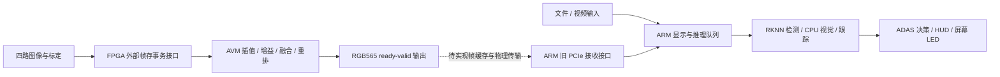

> **2026-10-30 当前板端工程入口：[`board_project/`](board_project/README.md)。**
> 640×640双模型交替推理，保留传统车道、短时跟踪、键盘导航和四路侧向安全判断。本版在已选车道边界附近补充阴影、淡漆的原图证据复核，普通前方风险显示“减速 · 保持车道”，并下移底部行为图标；保留板卡原有的检测与显示调整，车道长度、预警比例及安全阈值以本轮开始时状态为准。FPGA通信及原控制按钮逻辑未改，驱动完整包含在[`board_project/drivers/pango_pci_driver_mul.ko`](board_project/drivers/pango_pci_driver_mul.ko)。克隆后进入`board_project/`执行`./build.sh`，再执行`./run_adas.sh`。
> 六段单路HDMI视频440个采样、每版880次真实推理无运行失败或候选溢出；补回24次原为未知的实线判断，原有已知类型与拟合坐标不变，Qt回归42项通过。补充原图复核有计算代价：独立车道平均79→106ms，P95为108→196ms，不能宣称达到15Hz；真实FPGA实流及显示总延迟仍待验收。详见[车道与显示验证](board_project/docs/lane-display-verification-2026-10-30.md)、[模型接入](board_project/docs/model-replacement-roadmap.md)、[迁移说明](board_project/docs/rk3568-migration.md)和[工程清理](board_project/docs/project-cleanup-2026-10-28.md)。测试源码保留，测试视频、截图、日志和ARM编译产物不纳入发布。
> 原有`arm/`、`fpga/`工程及下述历史说明原样保留，与`board_project/FPGA`不混用。

# RK3568_50H 四路环视与 ARM ADAS 工程

本工程面向紫光同创 RK3568_50H 平台，包含 FPGA 四路地面鸟瞰拼接核心，以及 RK3568 上的 Qt 视频显示、RKNN 推理和 ADAS 演示软件。

**当前是两个可独立开发、验证的子工程，FPGA 环视输出与 ARM 应用尚未完成板级接通。** FPGA 已有 ModelSim 仿真、PDS 综合和无 SDF 综合网表功能验证；ARM 随工程带入了板端文件回放的历史记录。本次目录整理后的实际检查见 [验证报告](doc/validation/README.md)。

## 1. 当前实现与验证范围

| 部分 | 已有内容 | 当前边界 |
|---|---|---|
| FPGA AVM | 四路 RGB565 帧存读取、坐标映射、双线性插值、增益与接缝融合、光栅重排 | 输入由内存事务模型提供，尚无板级相机采集/物理 DDR 顶层 |
| FPGA 验证 | Python 位精确参考、MATLAB 独立参考、ModelSim 单元/整帧、PDS ADS 综合、720p 网表功能仿真 | 无布局布线、SDF、真实板卡帧率或完整 bitstream |
| ARM 应用 | Qt 5 显示、文件回放、旧 PCIe 接收、车牌/交通检测、跟踪、车道线/导航识别、ADAS 规则与 HUD | 所带 RKNN 运行库和驱动是 Linux AArch64 二进制，需匹配板端环境 |
| ARM 历史验证 | 导入记录描述了 RK3568 LubanCat 上的构建、文件输入与 GUI 检查 | 当时无 PCIe 驱动设备；不是本机重测，也不是本 FPGA 核心的联调证据 |
| 本次 ARM 主机验证 | 在 WSL 上编译运行 CPU 测试，并检查 qmake、资源部署和启动参数 | 不执行 AArch64 NPU、内核驱动或完整 GUI 应用 |
| FPGA ↔ ARM | ARM 保留旧 PCIe/I2C 接口代码 | AVM 核心尚未实现对应寄存器、DMA、帧缓冲管理及实体 LED 通路 |

“360 环景”在这里指四路图像的**二维地面鸟瞰拼接**。高物体拉伸、运动重影、真实标定与同步问题仍需实拍验证。ARM 车道/交通算法处理的透视图像与鸟瞰输出有不同语义，接入时需要明确输入流和 ROI，不能仅凭相同分辨率认定兼容。

## 2. 目录

```text
ADAS/
├── README.md / LICENSE / .gitignore / .gitattributes
├── arm/                           ARM 软件根目录
│   ├── adas_arm.pro               Qt 5 qmake 工程，目标 img_recv_demo
│   ├── build.sh / run.sh           构建、部署模型、启动
│   ├── src/                       UI、核心算法、推理、硬件与公共代码
│   ├── tests/                     CPU 测试及运行脚本
│   ├── tools/                     场景生成、模型转换、RKNN 诊断
│   ├── resources/                 QSS、图标
│   ├── models/                    原始 RKNN 模型与资产说明
│   ├── third_party/               RKNN 运行库/头文件、ztu 头文件
│   ├── drivers/prebuilt/          仅提供二进制的旧 PCIe 驱动
│   ├── doc/history/               导入的计划和板端记录
│   └── build/                     本地生成，不纳入版本控制
├── fpga/                          FPGA 自包含子工程
│   ├── src/rtl/ / src/files.f      唯一维护的生产 RTL
│   ├── sim/                       ModelSim 入口、TB、DDR 模型、样例
│   ├── constraints/               核心时钟约束
│   ├── project/pds/               PDS 工程模板
│   ├── tools/avm/                 Python/MATLAB 模型及仿真/综合运行器
│   ├── doc/                       FPGA 接口、说明、历史和验证证据
│   ├── build/                     隔离构建、仿真输出及旧发布 checkout
│   └── archive/                   原 FPGA 备份与历史资料
├── doc/                           整体架构、接口状态、计划、验证报告
├── tools/release/                 暂存内容、敏感信息和文档链接检查
└── archive/                       本地备份目录，不随 Git 提交
```

`src/`、`sim/`、`doc/` 在需要它们的子工程中就近维护。所有 FPGA 文档内未特别注明的命令都从 `fpga/` 执行；ARM 文档内命令从 `arm/` 执行。历史资料保留当时路径，当前入口以各子工程 README 为准。

## 3. FPGA 快速使用（Windows）

依赖 Python 3.10+（本机 3.13）、ModelSim 10.7、PDS 2022.2-SP6.4；独立 MATLAB 参考使用 R2024b。确保 `vlib`、`vmap`、`vlog`、`vsim` 在 PATH。

从远端克隆后进入 FPGA 子工程（私有仓库需要已有访问权限）：

```powershell
git clone https://github.com/StellatoL/FPGARACE_2026_Pango_3.git
cd FPGARACE_2026_Pango_3/fpga
python -m pip install -r tools/avm/requirements.txt
python -X utf8 tools/avm/generate.py --case small
python -X utf8 sim/run.py --case small --profile stress --wave
python -X utf8 tools/avm/run_units.py
```

完整算法与 RTL 验证（首次生成公开样例需要网络）：

```powershell
python -u -X utf8 tools/avm/run_all.py --regenerate --matlab --full-stress
```

已有完整样例时可执行 `python -u -X utf8 tools/avm/run_all.py --full-stress`，这会复用已有 MATLAB 参考。综合命令为：

```powershell
python -u -X utf8 tools/avm/run_pds.py --label baseline
```

之后按打印的构建路径运行综合网表仿真，详见 [FPGA README](fpga/README.md)、[PDS 入口](fpga/project/README.md)。生成的 `.pds` 是算法核心综合工程；目前不能作为板级成品直接烧录。

## 4. ARM 快速使用（板端 Linux AArch64）

完整应用需要 RK3568 的 64 位 Linux、Qt 5、OpenCV 4，以及与板端 NPU 驱动匹配的 RKNN 运行库。仓库附带 [Pango PCIe 驱动](arm/drivers/prebuilt/pango_pci_driver_mul.ko)，但不附带模型、RKNN 运行库和受限的 `rknn_api.h`；先按 [SDK 放置说明](arm/third_party/README.md) 补齐依赖并核对 [资产清单](arm/models/assets.json)。驱动适配条件见 [驱动说明](arm/drivers/README.md)。

Ubuntu/Debian 板端依赖安装与构建示例：

```bash
cd arm
sudo apt-get update
sudo apt-get install build-essential qtbase5-dev qt5-qmake pkg-config \
  libopencv-dev libopencv-contrib-dev libfreetype6-dev
bash build.sh --check
bash build.sh
bash run.sh
```

直接进入 ADAS 文件回放：

```bash
bash run.sh --adas /absolute/path/to/road.mp4
```

默认输出 `arm/build/release/`。构建脚本将运行库和全部模型复制到输出目录，启动器处理样式路径；也支持带空格的路径。`BUILD_DIR` 在构建与运行时应保持一致，相对路径以 `arm/` 为基准。`NO_RGA=1 bash build.sh` 可以关闭可选 RGA 分支。

本机 x86_64 WSL 可以执行 CPU 测试：

```bash
bash arm/tests/run_host_tests.sh
```

它不会运行 RKNN 或加载 `.ko`。完整应用构建、诊断、视频 E2E 及模型转换说明见 [ARM README](arm/README.md)。

## 5. 整体数据通路



实线描述子工程已存在的通路；跨端虚线是待实现的连接。原 ARM I2C 命令属于旧设计，不能直接控制当前 `avm_core`。缓冲所有权、丢帧策略、帧同步、颜色布局和复位流程都需要统一，详见 [接口与联调状态](doc/integration-status.md)。

## 6. 结果如何解读

FPGA 已有结果中，有限接缝 720p 标称内存场景为 28.31660 ms，全交叠为 36.34548 ms，随机压力为 54.58745 ms。后两者未达到 30 fps。这些是事务模型下从帧就绪到最后像素的处理耗时，不是相机到显示的实测延迟。

1280×720 综合使用 9,732 LUT、8,871 寄存器、52 DRM36K、66 APM；综合估计 103.8529 MHz，100 MHz 目标 slack +0.371 ns。此数值不是布局布线后的签核。历史公开摘要见 [FPGA 验证摘要](fpga/doc/validation/README.md)，本次重跑及资产完整性见 [本次验证报告](doc/validation/README.md)。

ARM 历史记录中的“上板”只指该记录描述的 ARM 文件回放环境，不能解释为四路相机、AVM、PCIe、RK3568 显示整机链路已经通过。ADAS 的速度输入包含演示用模拟量，LED 为屏幕显示；当前没有实体执行器控制闭环。

## 7. 下一步联调顺序

1. 根据 RK3568_50H 原理图核实实际 FPGA 型号、封装、DDR、相机及 FPGA—ARM 连接；当前 PDS 目标为 `PG2L50H-6IFBG484`，ARM 旧文档中的其他型号不作为约束依据。
2. 建立 FPGA 板级顶层、四路采集、物理 DDR、帧同步与真实管脚/时钟约束。
3. 约定传输协议和帧所有权，提供可复编驱动及 MMIO/DMA 适配，明确送往 ARM 的鸟瞰/前视流。
4. 在 RK3568 核对 RKNN 版本、模型输入输出、真实视频识别质量、缓冲稳定性和 GUI 延迟。
5. 完成 CDC、布局布线与时序签核，再执行相机到显示的长时间板级验证并更新状态。

## 8. 提交范围、验证证据与许可

本次提交将此前单独的 FPGA 工程移入 `fpga/`，加入 `arm/` 源码、脚本和系统文档。提交继承原仓库历史和可见性，没有上传本地备份、会话便笺、原始工具日志、仿真工作库或厂商安装文件。

四个 RKNN 模型、`librknnrt.so` 和受限的 `rknn_api.h` 需在兼容且获授权的环境中自行准备。路径、SHA256 和角色见 [资产清单](arm/models/assets.json) 与 [SDK 说明](arm/third_party/README.md)。补齐之前，ARM CPU 测试可以运行，完整应用构建会明确提示缺少资产。

用户要求随仓库提交 `pango_pci_driver_mul.ko`。提交副本仅替换 4 处非加载调试区中的个人编译目录，其他字节均经核验未变；本地原件保留。驱动标注 `GPL v2`、`6.1.99 SMP mod_unload aarch64`，没有驱动源码或板级加载验证，详见 [处理记录](arm/drivers/prebuilt/publication-metadata.json)。

[验证摘要](doc/validation/README.md) 提供真实结果、PASS 摘录和源码哈希；它们是经过筛选的摘要，不是完整原始日志。本次未执行 ARM 完整应用或跨端板级验证。后续修改应重新运行相关检查再更新状态。

提交前可运行 `python tools/release/check_publication.py --self-test` 和 `python tools/release/check_publication.py`，检查实际 Git 暂存 blob、文件范围、敏感模式、图片元数据、链接与源码哈希。后续新增文件需同步维护发布清单，见 [发布工具说明](tools/release/README.md)。

根 [LICENSE](LICENSE) 保留原远端 Apache-2.0 原文。第三方封装保留导入内容，来源版本未完整提供，不由根 LICENSE 重新授予许可；RKNN SDK、模型、驱动按各自条款准备。FPGA 公开样例的 MIT 声明见 [第三方声明](fpga/tools/avm/THIRD_PARTY_LICENSE.txt)。

[整体架构](doc/architecture.md) · [文档索引](doc/README.md) · [ARM 说明](arm/README.md) · [FPGA 说明](fpga/README.md)
