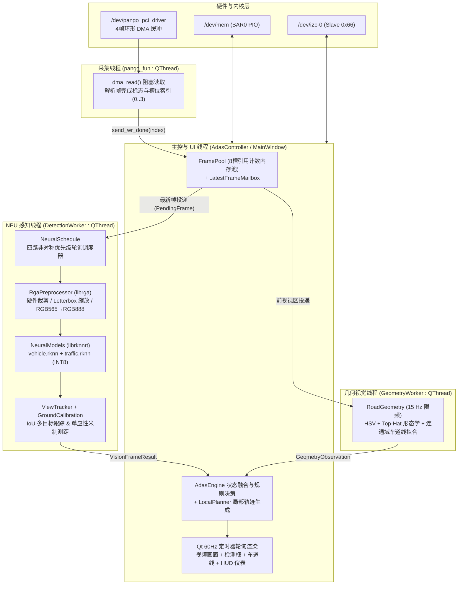

# RK3568 ARM 端软件工程说明

本目录包含运行于 **瑞芯微 RK3568J (AArch64 Linux)** 上的 ADAS 核心上位机软件源码、RKNN 双模型包、PCIe 内核驱动二进制与构建脚本。软件基于 **C++17 + Qt 5 + OpenCV 4 + RGA + RKNN Runtime** 构建，编译产物为 `img_recv_demo`（工程文件沿用历史命名 `ZYNQ_video_show.pro`）。

## 软件架构与线程模型

ARM 端采用多线程异步流水线架构，将高频视频帧接收、硬件图像预处理、NPU 深度学习推理、CPU 车道几何分析与 Qt GUI 渲染解耦，通过无锁原子序号与最新帧覆盖邮箱（Latest-Frame Mailbox）消除队列积压延迟，确保端到端系统延迟稳定在 **80 ms – 100 ms**。



### 核心模块划分 (`src/`)

| 目录 / 文件 | 核心类 / 模块 | 功能职责 |
| :--- | :--- | :--- |
| `src/main.cpp` | `main()` | 解析命令行参数（`--mode`、`--single-view`、`--quit-after`、`--report`、`--screenshot`、`--window-size`），加载 `style.qss` 并启动主窗口 |
| `src/common/frame_packet.h` | `FramePacket` / `FramePool` | 维护 1280×720 RGB565 帧内存池（8 个预分配缓冲区），封装四宫格（`Mosaic`）与单路（`Single`）视区坐标计算 `view_rect()` |
| `src/hardware/pango_fun.*` | `pango_fun` | 封装 `/dev/pango_pci_driver` 的 `ioctl`/`read` 调用、`/dev/mem` BAR0 `mmap` 寄存器读写，以及 `/dev/i2c-0` 视频源切换与 VIP 预处理控制 |
| `src/inference/rga_preprocessor.*` | `RgaPreprocessor` | 动态加载 `librga.so`，启动时执行 64×16 合成图像 RGB565→BGR888 硬件精度自检；运行时调用 `c_RkRgaBlit` 完成硬件裁剪、缩放与 RGB888 转换 |
| `src/inference/neural_schedule.h` | `NeuralSchedule` | 双模型与多视区时间片调度器，实现四路模式下**主前视常驻 + 其余三路按转向意图动态轮询** |
| `src/inference/neural_contract.*` | `read_neural_manifest` / `decode_neural_scene` | 校验 `manifest.json`（Schema v3、SHA256、锚框与类别契约），完成 YOLOv5 三尺度检测头解码与类别内精确 NMS（阈值 `IoU > 0.45`，置信度 `>= 0.25`） |
| `src/inference/neural_models.*` | `NeuralModels` | 管理 RKNN 双模型上下文（`vehicle.rknn` 与 `traffic.rknn`），串联 RGA 预处理、NPU 推理与坐标逆映射 |
| `src/core/road_geometry.*` | `RoadGeometry` | 基于 HSV 白/黄颜色掩膜、水平形态学 Top-Hat 变换与连通域分析提取前视左右车道线，输出线性方程参数、中心偏移及实线/虚线分类 |
| `src/core/view_tracker.h` | `ViewTracker` | 分视区多目标跟踪器，结合 IoU 与中心归一化距离关联历史轨迹，支持短暂漏检外推预测（最长保留 `0.45 s`） |
| `src/core/ground_calibration.*` | `GroundCalibration` | 前视路面四点单应性矩阵（Homography）求解与持久化，将检测框底边中心像素映射为纵向米制距离 |
| `src/core/adas_engine.*` | `AdasEngine` | 多源异步感知结果时间戳对齐、3/5 滑动窗口状态消抖确认、TTC 碰撞风险评估、红绿灯/变道/斑马线礼让/超速规则决策 |
| `src/core/local_planner.h` | `LocalPlanner` | 基于当前车道几何与障碍物包络约束，生成 16 点三次 Hermite 插值局部行驶或变道轨迹 |
| `src/ui/adas_controller.*` | `AdasController` | 统筹实时帧接收、工作线程启停、UI 控件与键盘快捷键响应、HUD 矢量图层绘制、地面标定对话框及 JSON 性能报告导出 |

## 感知流水线与调度策略

### 1. 双 RKNN 模型契约 (`models/adas/manifest.json`)

系统在 NPU 上同时加载两个 INT8 量化的 YOLOv5 模型（输入尺寸均为 `640×640`，`NHWC RGB8`，均值 `0`、标准差 `255`）：

| 模型文件 | 角色标识 | 输出契约类型 | 检测类别与后处理分工 |
| :--- | :--- | :--- | :--- |
| `vehicle.rknn` | `SceneModelRole::Vehicle` | `yolov5_rk_sigmoid_nchw_v1` | 基于 COCO 80 类，筛选 `{0: person, 1: bicycle, 2: car, 3: motorcycle, 5: bus, 7: truck}`，映射为行人（类别 1）与车辆（类别 10），送入 `ViewTracker` 跟踪与测距 |
| `traffic.rknn` | `SceneModelRole::Traffic` | `yolov5_raw_nchw_v1` | 专训 6 类：`{crosswalk, person, light_red, light_green, light_black, light_yellow}`，负责前视三车道 ROI 红绿灯状态判别及全视区斑马线、斑马线行人共现判定 |

### 2. 四路与单路 YOLO 推理调度机制 (`NeuralSchedule`)

为在 RK3568 有限的 NPU 算力下兼顾前向高实时性与环视盲区感知，`NeuralSchedule` 采用**模型角色交替（`Vehicle` ↔ `Traffic`）+ 视区非对称周期调度**：

- **四路环视模式（`Layout::Mosaic`，1280×720 四宫格输入）**：
  - 视区划分：左上 `Front (0)`、右上 `Right (1)`、左下 `Rear (2)`、右下 `Left (3)`，每个子视区尺寸为 `640×360`。
  - **调度周期与优先级**：
    - **主前视（`Front`）**：调度周期最短（`125 ms`，最高优先级 `0`），保持常驻高频识别。
    - **其余三路（`Right` / `Rear` / `Left`）**：无转向意图时以 `500 ms` 周期轮流采样；当驾驶员开启左转或右转向灯（`TurnSignal::Left` / `Right`）时，对应目标变道侧视区优先级提升至 `1`，采样周期缩短至 `250 ms`，其余非关键视区放宽至 `1000 ms`。
  - **实测表现**：在四路模式下，系统始终维持**主前视常驻识别 + 轮流采样其余三路**（等效于同时有两路画面处于活跃识别状态），**YOLO 综合识别帧率稳定在 10 FPS 左右**。
- **单路 HDMI 模式（`Layout::Single`，1280×720 全幅前视输入）**：
  - 全部 NPU 调度周期集中于 `Front (0)` 单一视区，交替执行 `Vehicle` 与 `Traffic` 模型推理，**YOLO 识别帧率约为 20 FPS**。
- **系统端到端延迟**：从视频源输入、FPGA 采集处理、PCIe DMA 传输到 ARM 完成推理与 HUD 界面刷新，**端到端延迟约为 80 ms – 100 ms**。

### 3. 决策与安全状态机 (`AdasEngine`)

`AdasEngine` 对异步到达的各视区感知结果执行严格的有效期管理（前视默认超时 `0.5 s`，侧/后视默认超时 `1.5 s`）与 **5 帧中至少 3 帧命中（3-of-5 Confirm）** 的抗抖动确认：

- **十字路口信号灯控制**：支持左转、直行、右转三个车道独立配置信号灯 ROI。红灯或黄灯确认时输出停车指令（`stop_required = true`）；若在红灯状态下触发手动“强制行驶”，立即触发闯红灯报警（`alarm_red_run = true`）。
- **虚实线变道辅助与盲区保护**：当输入左/右变道意图时，引擎同时核验：① 对应侧车道线已确认为**虚线（`Dashed`）**；② 前视与目标侧视区（左视或右视）在变道请求发起后已有新鲜且无障碍的感知帧；③ `LocalPlanner` 校验目标车道与过渡轨迹无碰撞风险。若跨实线强制变道，立即触发实线变道报警（`alarm_illegal_lane_change = true`）。
- **行人礼让与 TTC 碰撞急刹**：当前视行驶走廊内检测到近距行人（框底 `> 0.75×H` 或标定距离 `< 3.0 m`）、斑马线上有行人（`person_on_zebra`），或根据历史轨迹计算的碰撞时间 `TTC` 低于阈值（车辆 `< 1.2 s`，行人 `< 2.0 s`）时，立即锁存紧急制动状态（`brake_now = true`）并触发碰撞报警（`alarm_collision = true`），需连续 3 帧无风险后方可解除。

## 环境要求与构建说明

### 1. 软硬件依赖

- **目标架构**：RK3568 / RK3568J，`aarch64-linux-gnu`（64 位 Linux 系统）。
- **编译与基础库**：`g++` (支持 C++17)、`qmake` (`qtbase5-dev`)、`make`、`pkg-config`、`libopencv-dev` (OpenCV 4.x)。
- **硬件加速运行时**：
  - **RKNN Runtime**：仓库已内置 `third_party/rknn/lib/librknnrt.so`（API 版本前缀 `2.3.2`）与头文件。
  - **RGA 库**：需板端 BSP 提供 `librga.so`（或 `librga.so.2`）及开发头文件 `/usr/include/rga/{RgaApi.h,drmrga.h,rga.h}`。**注意**：工程强制要求通过 RGA 硬件完成神经网络输入预处理，禁用了 CPU 图像缩放/色彩转换降级路径。

### 2. 编译步骤

在 RK3568 板端进入 `arm/` 目录执行：

```bash
# 仅检查编译器、Qt5、OpenCV、RGA 头文件及模型完整性
bash build.sh --check

# 若缺少基础 Debian/Ubuntu 开发包，可自动调用 apt 安装
bash build.sh --install-deps

# 执行完整构建（生成物位于 arm/build_adas/img_recv_demo）
bash build.sh
```

`build.sh` 会自动在 `arm/build_adas/` 下创建指向 `models/`、`resources/`、`config/` 的符号链接，并将 `third_party/rknn/lib/librknnrt.so` 链接为 `librknnrt.so.1`。

## 运行参数与交互指南

### 1. 命令行参数

通过 `run_adas.sh` 或直接运行 `build_adas/img_recv_demo` 支持以下参数：

```bash
# 默认以 ADAS 模式启动
sh ./run_adas.sh

# 启动时默认进入纯视频显示模式（不运行 NPU/CPU 感知）
sh ./run_adas.sh --mode raw

# 初始布局设为单路前视（连接设备后会根据 FPGA I2C 实际源状态自动同步）
sh ./run_adas.sh --single-view

# 自动化评测模式：运行 30 秒后自动保存界面截图与 JSON 性能诊断报告并退出
sh ./run_adas.sh --mode adas --quit-after 30 --report /tmp/adas_report.json --screenshot /tmp/adas_ui.png --window-size 1280x720
```

### 2. 键盘快捷键说明（ADAS 模式下生效）

| 快捷键 | 功能说明 | 对应动作枚举 (`ManualAction`) |
| :--- | :--- | :--- |
| `1` / `2` / `3` | 切换自车当前所在车道（`1`=左转车道，`2`=直行车道，`3`=右转车道） | 切换车道下拉框 |
| `↑` (Up) | 恢复正常自动行驶（清除手动停车与强制标志） | `ManualAction::Drive` |
| `Ctrl + ↑` | **强制行驶**（用于演示红灯状态下强行起步触发闯红灯报警） | `ManualAction::ForceDrive` |
| `↓` (Down) / `Space` | 手动停车 / 切换停车与行驶状态 | `ManualAction::Stop` / `ToggleStop` |
| `←` / `W` / `→` | 设置手动导航意图为：左转 / 直行 / 右转（联动对应转向灯） | `NavigateLeft` / `Straight` / `Right` |
| `N` / `Esc` | 循环切换导航方向 / 清除当前导航意图 | `CycleNavigation` / `ClearNavigation` |
| `A` / `D` | 开启或关闭左转向灯 / 右转向灯（发起普通变道请求） | `SignalLeft` / `SignalRight` |
| `Ctrl + ←` / `J` | **强制左变道**（用于演示实线或盲区受阻时强行变道触发报警） | `ForceChangeLeft` / `ToggleForceLeft` |
| `Ctrl + →` / `L` | **强制右变道**（用于演示实线或盲区受阻时强行变道触发报警） | `ForceChangeRight` / `ToggleForceRight` |
| `V` | 切换四宫格全景显示 / 仅放大显示前视画面 | 切换 `仅前视画面` 复选框 |

### 3. 配置文件 (`config/adas.ini`)

程序启动时自动按 `ADAS_CONFIG_PATH` 环境变量或相对路径读取 `config/adas.ini`，并在用户完成地面标定或信号灯 ROI 调整后自动持久化保存：
- `timing/front_timeout_s`：前视感知结果有效期（默认 `0.5` 秒，范围 `0.1 ~ 0.5` 秒）。
- `timing/side_timeout_s`：侧/后视感知结果有效期（默认 `1.5` 秒，范围 `0.2 ~ 1.5` 秒）。
- `<source>_<layout>/light_roi_<0..2>`：按视频源（`camera` / `hdmi`）与布局（`mosaic` / `single`）独立存储左、直、右三车道的信号灯归一化 ROI 坐标。
- `calibration_<source>_<layout>.ini`：独立存储对应模式下的地面四点像素坐标与实测米制矩形宽、长及车头近边偏移量。
